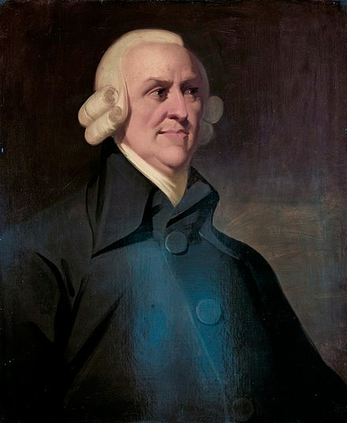

## {.duel background-color="#00395B" data-menu-title="Two views on free trade"}

<!-- slide 2.
     =========================================================================
     EcolEcon26 L05a — Free trade: blessing or curse? HTML (revealjs) version
     of the Keynote deck EcolEcon26_L05a_Trade.key (PDF export of 20.10.2026,
     29 slides). Same content, slide for slide; the slide numbers in the
     comments below are those of the PDF.

     WHAT IS DIFFERENT FROM THE KEYNOTE
     · Data figures are rebuilt from current data by
       analysis/trade_01_download.R + analysis/trade_02_figures.R (see the
       README there). That covers slides 14 (South Korea, both charts), 16
       (solar learning curve), 20 (commodity terms of trade), 21 (country-
       product matrix), 24 and 25 (product space). The numbers quoted in the
       text of slide 14 come from the same run — the figure script prints
       them; re-check them after every data refresh.
     · Slide 16, right-hand chart (IEA, solar PV module production by country)
       is still the image from the Keynote, marked PLACEHOLDER.
     · Diagrams (slides 7, 21, 26) are inline SVG, set in the deck's font.
     · Emoji are Twemoji images (emoji-img.lua), so flags render on Windows.
     · Slides 13 onwards were in the old master; they now use the new one.
     · Slide 27 is dropped and slides 28-29 live at the end of L05b — see the
       note at the end of this file.
     ========================================================================= -->

::: {.duel-row .top}
::: {.duel-quote}
The ideology of "free trade" has now overplayed its hand; it has exposed
itself as a farce. With democracy about to be sacrificed on the altar of free
trade, it has become abundantly clear that free trade was never meant to be
about freedom in the first place."
:::

<figure><figcaption>Jason Hickel</figcaption></figure>
:::

::: {.duel-bolt .fragment}
<svg viewBox="0 0 40 80" aria-hidden="true"><polygon points="26,0 4,46 19,46 12,80 36,30 21,30" fill="#69AACD"/></svg>
:::

::: {.duel-row .bottom .fragment}
<figure><figcaption>Jagdish Bhagwati</figcaption></figure>

::: {.duel-quote}
[T]he various social causes that we all embrace, such as advancement of gender
equality and reduction of poverty, are advanced, not set back, by
globalization. By looking at virtually every social concern I could lay my
hands on, […] globalization, by and large, advanced these social agendas
instead of handicapping them."
:::
:::

## Starting activity

<!-- slide 3 -->

::: {.columns}
::: {.column width="62%"}
- Sit together with 2-3 neighbours and discuss for about 5 minutes the
  following question: Is free trade something positive or negative?
  - Exchange ideas within your group
  - After 5 minutes, cast your vote in the Tweedback survey
  - As a group post the two main arguments on the chatwall

::: {#start-timer .timer seconds="300" starton="interaction"}
:::
:::

::: {.column .qrcol width="38%"}


:::
:::

## Learning goals

<!-- slide 4 -->

::: {.upper-roman}
I.  Understand the classical justification of **free trade** and its historical origin
II. Learn about **challenges** to the free trade narrative
III. Think about the extent to which this is relevant for the **(trade) policy** of your country
:::

## Pro Free Trade {.divider background-color="#00395B"}

::: {.secnum}
01
:::

## Mercantilism

<!-- slide 6 -->

- 16^th^–18^th^ centuries: **absolutist states** and **hardly any international cooperation**.
- Basic idea: "The best for us, the worst for others."
- Mercantilism had its explicit theory of foreign trade
  - **Trade as a zero-sum game:** no increases in value, only redistribution
- Trade as substitute for warlike actions:
  - Positive trade balance plus → more precious metal at home → wealth & military strength:
- **Policy implication:** high tariffs on imports of luxury goods, export bans on grain, etc.
  - The **environment** played no role in this debate

## Mercantilism: the role of the colonies

<!-- slide 7. The two boxes come with the second bullet; each arrow is then
     drawn on its own click, from its start to its end (class "draw", see
     euf-slides.scss), and its label fades in when the line has arrived. -->

- Sole purpose of colonies: serve interest of the colonizers
- Implications for 'trade policy':

  ```{=html}
  <svg class="diagram" viewBox="0 0 640 235" width="800" role="img" aria-label="Resources flow from the colony to the coloniser, final goods flow from the coloniser to the colony">
    <rect class="box" x="15" y="80" width="140" height="70" rx="10"/>
    <text class="boxlabel" x="85" y="123" text-anchor="middle">Coloniser</text>
    <rect class="box" x="485" y="80" width="140" height="70" rx="10"/>
    <text class="boxlabel" x="555" y="123" text-anchor="middle">Colony</text>
    <g class="fragment draw">
      <path class="stroke" pathLength="1" d="M 485 85 Q 320 20 158 84" fill="none" stroke="#00395B" stroke-width="3"/>
      <polygon class="head" points="0,0 -16,-8 -16,8" fill="#00395B" transform="translate(158,84) rotate(158.4)"/>
      <text class="lbl-teal" x="320" y="26" text-anchor="middle">Resources</text>
    </g>
    <g class="fragment draw">
      <path class="stroke" pathLength="1" d="M 155 145 Q 320 210 482 146" fill="none" stroke="#00395B" stroke-width="3"/>
      <polygon class="head" points="0,0 -16,-8 -16,8" fill="#00395B" transform="translate(482,146) rotate(-21.6)"/>
      <text class="lbl-light" x="320" y="226" text-anchor="middle">Final goods</text>
    </g>
  </svg>
  ```

- This 'division of labor' fixed by law

## Adam Smith: the theory of absolute advantage {auto-animate="true" data-auto-animate-id="smith"}

<!-- slide 8. Click order (explicit fragment indices, because the table cells
     have to be revealed by column, not by row): the four bullets (1-4), the
     left table (5), its relative values (6), then the right table (from 7),
     column group by column group, one country per click (7-15). Slides 8 and 9
     auto-animate into each other: the right table slides to the left. -->

::: {.columns}
::: {.column width="80%"}
::: {.nonincremental}

::: {.fragment fragment-index=1}
- In this time Adam Smith wrote his most famous works
:::

::: {.fragment fragment-index=2}
- Main reason for the "Wealth of Nations": the **division of labor**
:::

::: {.fragment fragment-index=3}
- International dimension: theory of **absolute advantage**
:::

::: {.fragment fragment-index=4}
- Two countries with different strengths in producing products → better **specialize and trade**:
:::

:::
:::

::: {.column .portrait width="20%"}
{width="245" alt="Adam Smith"}

Adam Smith<br>(1723-1790)
:::
:::

::: {.columns style="margin-top: 0.4em; gap: 2.4em;"}
::: {.column .fragment fragment-index=5 width="48%"}
<table class="econ">
<thead>
<tr><th rowspan="2"></th><th rowspan="2">L</th><th colspan="2">Possible production</th><th rowspan="2">Relative value</th></tr>
<tr><th></th><th></th></tr>
</thead>
<tbody>
<tr><td></td><td>100</td><td>20</td><td>10</td><td class="fragment" data-fragment-index="6">1  = 0.5 </td></tr>
<tr><td></td><td>100</td><td>16</td><td>12</td><td class="fragment" data-fragment-index="6">1  = 0.75 </td></tr>
</tbody>
</table>
:::

::: {.column .fragment fragment-index=7 width="48%"}
<table class="econ" data-id="smith-table">
<thead>
<tr><th rowspan="2"></th><th colspan="2">No trade</th><th colspan="2">Trade</th><th colspan="2">Change</th></tr>
<tr><th></th><th></th><th></th><th></th><th></th><th></th></tr>
</thead>
<tbody>
<tr><td></td><td class="fragment" data-fragment-index="7">10</td><td class="fragment" data-fragment-index="7">5</td><td class="fragment" data-fragment-index="10">20</td><td class="fragment" data-fragment-index="10">0</td><td class="fragment" data-fragment-index="13">+10</td><td class="fragment" data-fragment-index="13">-5</td></tr>
<tr><td></td><td class="fragment" data-fragment-index="8">8</td><td class="fragment" data-fragment-index="8">6</td><td class="fragment" data-fragment-index="11">0</td><td class="fragment" data-fragment-index="11">12</td><td class="fragment" data-fragment-index="14">-8</td><td class="fragment" data-fragment-index="14">+6</td></tr>
<tr><td></td><td class="fragment" data-fragment-index="9">18</td><td class="fragment" data-fragment-index="9">11</td><td class="fragment" data-fragment-index="12">20</td><td class="fragment" data-fragment-index="12">12</td><td class="fragment" data-fragment-index="15">+2</td><td class="fragment" data-fragment-index="15">+1</td></tr>
</tbody>
</table>
:::
:::

## Adam Smith: the theory of absolute advantage {auto-animate="true" data-auto-animate-id="smith"}

<!-- slide 9 -->

::: {.columns}
::: {.column width="80%"}
::: {.nonincremental}
- In this time Adam Smith wrote his most famous works
- Main reason for the "Wealth of Nations": the **division of labor**
- International dimension: theory of **absolute advantage**
- Two countries with different strengths in producing products → better
  **specialize and trade**:
:::
:::

::: {.column .portrait width="20%"}
{width="245" alt="Adam Smith"}

Adam Smith<br>(1723-1790)
:::
:::

::: {.columns style="margin-top: 0.4em; gap: 2.4em; align-items: center;"}
::: {.column width="48%"}
<table class="econ" data-id="smith-table">
<thead>
<tr><th rowspan="2"></th><th colspan="2">No trade</th><th colspan="2">Trade</th><th colspan="2">Change</th></tr>
<tr><th></th><th></th><th></th><th></th><th></th><th></th></tr>
</thead>
<tbody>
<tr><td></td><td>10</td><td>5</td><td>20</td><td>0</td><td>+10</td><td>-5</td></tr>
<tr><td></td><td>8</td><td>6</td><td>0</td><td>12</td><td>-8</td><td>+6</td></tr>
<tr><td></td><td>18</td><td>11</td><td>20</td><td>12</td><td>+2</td><td>+1</td></tr>
</tbody>
</table>
:::

::: {.column style="width: 48%; text-align: center; color: #6F6F6F; font-size: 1.05em;"}
::: {.fragment}
🇩🇪 could trade 8.1-9.9 units 🥨 for<br>5.1-5.9 units of 🍱 from 🇯🇵
:::

::: {.fragment}
<svg viewBox="0 0 60 50" width="72" aria-hidden="true"><polygon points="18,0 42,0 42,22 60,22 30,50 0,22 18,22" fill="#000"/></svg>

Corridor in which both would win
:::
:::
:::

## David Ricardo: the theory of *comparative* advantage {auto-animate="true" data-auto-animate-id="ricardo"}

<!-- slide 10. The table auto-animates into its place on slide 11. -->

::: {.columns style="align-items: center;"}
::: {.column width="58%"}
- Ricardo also one of the most famous economists of the classical age
- Addressed Smith's theory of absolute advantage
  - Trade beneficial, even if one country was always better
  - Key: comparative advantages → opportunity costs
- Ricardo's classical example:
  - 🇵🇹 with absolute advantage for both goods
  - Still, both countries would benefit from trade
  - Reason: Differences in opportunity costs<br>→ **Comparative advantage**
:::

::: {.column style="width: 42%; text-align: center;"}
::: {.portrait}
{width="260" alt="David Ricardo"}

David Ricardo<br>(1772-1823)
:::

::: {.fragment style="display: flex; justify-content: center; margin-top: 0.8em;"}
<table class="econ requirements" data-id="req-table">
<thead>
<tr><th></th><th colspan="2">Requirements</th></tr>
<tr><th></th><th></th><th></th></tr>
</thead>
<tbody>
<tr><td></td><td>80</td><td>90</td></tr>
<tr><td></td><td>120</td><td>100</td></tr>
</tbody>
</table>
:::
:::
:::

## Comparative advantage: one example {auto-animate="true" data-auto-animate-id="ricardo"}

<!-- slide 11 -->

::: {.columns style="gap: 1.6em;"}
::: {.column width="66%"}
- Relation of input costs is $80/120 = 0.67$ for 🍷 and $90/100 = 0.9$ for 🧥
  - 🇵🇹 has a bigger advantage when it comes to 🍷
- Opportunity costs for 🇵🇹: $90/80 = 1.125$
  - For 🇵🇹 the production of 1 🧥 comes with giving up on the production of 1.125 🍷
- Opportunity costs for 🏴󠁧󠁢󠁥󠁮󠁧󠁿: $100/120 = 0.833$ → 🧥 relatively cheaper in 🏴󠁧󠁢󠁥󠁮󠁧󠁿
  - For 🏴󠁧󠁢󠁥󠁮󠁧󠁿, the production of 1 🧥 comes with giving up on the production of 0.833 🍷
:::

::: {.column width="34%"}
<table class="econ requirements" data-id="req-table">
<thead>
<tr><th></th><th colspan="2">Requirements</th></tr>
<tr><th></th><th></th><th></th></tr>
</thead>
<tbody>
<tr><td></td><td>80</td><td>90</td></tr>
<tr><td></td><td>120</td><td>100</td></tr>
</tbody>
</table>
:::
:::

## Comparative advantage: one example

<!-- slide 12. Deliberately not auto-animated: the table just stays put. -->

::: {.columns style="gap: 1.6em;"}
::: {.column width="66%"}
- 🏴󠁧󠁢󠁥󠁮󠁧󠁿: people work 220 hours to produce 1 🍷 and 1 🧥
- 🇵🇹: people work 170 hours to produce the same
- If both countries specialised according to their comparative advantage….
  - 🇵🇹 would produce $170/80 = 2.125$ 🍷 (and no 🧥) → 0.125 more
  - 🏴󠁧󠁢󠁥󠁮󠁧󠁿 would produce $220/100 = 2.2$ 🧥 (and no 🍷) → 0.2 more
  - If 🏴󠁧󠁢󠁥󠁮󠁧󠁿 traded 1 🧥 for 1-1.125 🍷, both countries would have more than before!
:::

::: {.column width="34%"}
<table class="econ requirements" data-id="req-table">
<thead>
<tr><th></th><th colspan="2">Requirements</th></tr>
<tr><th></th><th></th><th></th></tr>
</thead>
<tbody>
<tr><td></td><td>80</td><td>90</td></tr>
<tr><td></td><td>120</td><td>100</td></tr>
</tbody>
</table>
:::
:::

::: {.arrowkey .fragment}
::: {.bigarrow}
➡
:::

::: {.keybox}
This simple narrative continues to be at the core of many trade debates and analyses!
:::
:::

## Other advantages of free(er) trade

<!-- slide 13 -->

- Numerous other arguments for free(r) trade, especially in economics:
  - Exploitation of **economies of scale** and corresponding efficiency gains
  - Increasing the **variety of products** that consumers can buy.
  - Larger markets increase the incentive for **innovation**
  - Integration into global markets leads to **learning effects**
  - Export markets offer **growth potential** to poorer countries with weak domestic demand
  - Access to capital and technology might allow **industrial upgrading** in developing countries
- Indisputable: trade liberalization produces **winners and losers**
  - But: overall gains large enough to **compensate** for losers (?)

## Example case: South Korea

<!-- slide 14. All charts and the two numbers in the bullets come from
     analysis/trade_02_figures.R; the Keynote said "more than 27 times" and
     "1.4% in 1962, and is 47% of exports in 2024".
     Click order follows the DOM: GDP chart, bullet 1, bullet 2, export
     values, export shares, bullet 3, bullet 4. The two export charts sit
     inside bullet 2 but are positioned absolutely on the left. -->

::: {.korea}
::: {.fragment .k-gdp}
{width="100%" fig-alt="GDP per capita 1820-2022 for South Korea, Western Europe, the World and Sub-Saharan Africa"}
:::

::: {.k-bullets}
- Archetype for **export-driven development**
- Machinery was 1.3% in 1962, and is 53% of goods exports in 2024

  ::: {.fragment .k-fig1}
  {width="100%" fig-alt="South Korea's goods exports by product group, 1962-2024, in US dollars"}
  :::

  ::: {.fragment .k-fig2}
  {width="100%" fig-alt="South Korea's goods exports by product group, 1962-2024, as shares"}
  :::
- In 2022, GDP per capita is more than 26 times as high as 1960
- But note cautionary remarks later
:::
:::

## Trade and the environment

<!-- slide 15 -->

- **Potential synergies:**
  - Access to green technologies (solar panels, wind turbines)
  - Export revenues fund conservation
  - Market incentives for sustainable practices
- **Key conditions:**
  - Ability to capture value (not just raw material extraction)
  - Technology transfer and learning actually happens (no excessive IPR)
  - Supportive institutions and policies

## Example: China and the solar panel boom

<!-- slide 16. Both charts are ours now: left from Our World in Data, right
     hand-entered from IEA-PVPS (2025), see
     analysis/data-manual/README-pv_module_production_2024.txt. -->

::: {.columns style="gap: 1.4em; align-items: center;"}
::: {.column .fragment width="52%"}
{width="100%" fig-alt="Solar PV module prices against cumulative installed capacity, 1975-2024, both on log scales"}
:::

::: {.column .fragment width="48%"}
{width="100%" fig-alt="Solar PV module production by country in 2024: China 629 of 728 GW"}
:::
:::

- The success of solar power is due to the success of China in producing
  cheaper and cheaper PV panels

## Break and discussion

<!-- slide 17 -->

::: {.columns}
::: {.column width="60%"}
- Sit together with 2-3 neighbours and discuss for about 5 minutes the
  following question:
  - Which were the main arguments in favour of free trade?
  - Which of the arguments did you find convincing? Which ones not?
  - Are factors that you find important, but that were not taken into
    account in the previous arguments in favour of free trade?
- **Post your results on the chatwall!**

::: {#discussion-timer .timer .timer-sm seconds="300" starton="interaction"}
:::
:::

::: {.column .qrcol width="40%"}


:::
:::

## Contra Free Trade {.divider background-color="#00395B"}

::: {.secnum}
02
:::

## A nuanced view on trade

<!-- slide 19 -->

- **What you export matters**
  - For development
  - For the environment
- **Problem: trade is often unequal**
  - In terms of Value added
  - In terms of Environmental burdens
  - In terms of Terms of Trade
- Example: The **Prebisch-Singer Hypothesis**
- **Revisiting the South Korea and Chinese examples**

## The Terms-of-Trade problem

<!-- slide 20. The chart is rebuilt: Grilli-Yang index 1900-2016, extended
     to the latest Pink Sheet year. It sits inside the bullet after which it
     appears, positioned absolutely on the right. -->

::: {.rel}
::: {style="width: 52%;"}
- Ratio of export prices to import prices
  - Small ToT: export more to import the same amount
- **Prebisch-Singer Hypothesis:**
  - **Primary commodity prices** decline relative to manufactured goods

    ::: {.fragment .abs-right style="top: 0; width: 47%;"}
    {width="100%" fig-alt="Real price of primary commodities relative to manufactures, 1900 to 2025, with a falling linear trend"}
    :::
  - Countries exporting raw materials face **deteriorating terms**
  - To import the same amount → must export more over time
- **Systematic disadvantage** for commodity exporters
:::
:::

## Technologically unequal exchange

<!-- slide 21. The diagram sits inside the first bullet (positioned on the
     right), so it appears right after it. -->

::: {.subhead}
Economic complexity
:::

::: {.rel}
::: {style="width: 64%;"}
- Idea of **economic complexity**: measure collective knowledge by looking at
  the things people produce

  ::: {.fragment .abs-right style="top: -0.6em; width: 34%;"}
    ```{=html}
    <svg class="diagram" viewBox="0 0 300 250" width="300" role="img" aria-label="Countries are linked to capabilities, capabilities to products; collapsing the middle layer links countries directly to products">
      <style>
        .c { fill: #8BC34A; stroke: #6A9A2E; }
        .a { fill: #9E9E9E; }
        .p { fill: #5BC0EB; stroke: #2E9CCB; }
        .ct { fill: #FFFFFF; font-size: 13px; font-weight: 600; }
        .hd { fill: #1A1A1A; font-size: 12px; }
        .l1 { stroke: #1C7F7B; stroke-width: 1; }
        .l2 { stroke: #2E9CCB; stroke-width: 1; }
        .l3 { stroke: #9E9E9E; stroke-width: 1; }
      </style>
      <text class="hd" x="30" y="12" text-anchor="middle">Countries</text>
      <text class="hd" x="150" y="12" text-anchor="middle">Capabilities</text>
      <text class="hd" x="262" y="12" text-anchor="middle">Products</text>
      <!-- tripartite links -->
      <line class="l1" x1="40" y1="30" x2="140" y2="30"/><line class="l1" x1="40" y1="30" x2="140" y2="66"/>
      <line class="l1" x1="40" y1="66" x2="140" y2="66"/><line class="l1" x1="40" y1="66" x2="140" y2="102"/>
      <line class="l1" x1="40" y1="102" x2="140" y2="102"/><line class="l1" x1="40" y1="30" x2="140" y2="102"/>
      <line class="l2" x1="160" y1="30" x2="252" y2="30"/><line class="l2" x1="160" y1="66" x2="252" y2="30"/>
      <line class="l2" x1="160" y1="66" x2="252" y2="66"/><line class="l2" x1="160" y1="102" x2="252" y2="66"/>
      <line class="l2" x1="160" y1="102" x2="252" y2="102"/><line class="l2" x1="160" y1="30" x2="252" y2="102"/>
      <g><rect class="c" x="20" y="20" width="20" height="20" rx="3"/><text class="ct" x="30" y="35" text-anchor="middle">c₁</text></g>
      <g><rect class="c" x="20" y="56" width="20" height="20" rx="3"/><text class="ct" x="30" y="71" text-anchor="middle">c₂</text></g>
      <g><rect class="c" x="20" y="92" width="20" height="20" rx="3"/><text class="ct" x="30" y="107" text-anchor="middle">c₃</text></g>
      <g><polygon class="a" points="150,18 162,40 138,40"/><text class="ct" x="150" y="37" text-anchor="middle" style="font-size:11px">a₁</text></g>
      <g><polygon class="a" points="150,54 162,76 138,76"/><text class="ct" x="150" y="73" text-anchor="middle" style="font-size:11px">a₂</text></g>
      <g><polygon class="a" points="150,90 162,112 138,112"/><text class="ct" x="150" y="109" text-anchor="middle" style="font-size:11px">a₃</text></g>
      <g><circle class="p" cx="262" cy="30" r="10"/><text class="ct" x="262" y="35" text-anchor="middle">p₁</text></g>
      <g><circle class="p" cx="262" cy="66" r="10"/><text class="ct" x="262" y="71" text-anchor="middle">p₂</text></g>
      <g><circle class="p" cx="262" cy="102" r="10"/><text class="ct" x="262" y="107" text-anchor="middle">p₃</text></g>
      <!-- collapse arrow -->
      <polygon points="140,122 160,122 150,142" fill="#D5D5D5"/>
      <!-- bipartite -->
      <text class="hd" x="90" y="160" text-anchor="middle">Countries</text>
      <text class="hd" x="210" y="160" text-anchor="middle">Products</text>
      <line class="l3" x1="100" y1="178" x2="200" y2="178"/><line class="l3" x1="100" y1="178" x2="200" y2="210"/><line class="l3" x1="100" y1="178" x2="200" y2="242"/>
      <line class="l3" x1="100" y1="210" x2="200" y2="210"/><line class="l3" x1="100" y1="210" x2="200" y2="242"/>
      <line class="l3" x1="100" y1="242" x2="200" y2="242"/>
      <g><rect class="c" x="80" y="168" width="20" height="20" rx="3"/><text class="ct" x="90" y="183" text-anchor="middle">c₁</text></g>
      <g><rect class="c" x="80" y="200" width="20" height="20" rx="3"/><text class="ct" x="90" y="215" text-anchor="middle">c₂</text></g>
      <g><rect class="c" x="80" y="232" width="20" height="20" rx="3"/><text class="ct" x="90" y="247" text-anchor="middle">c₃</text></g>
      <g><circle class="p" cx="210" cy="178" r="10"/><text class="ct" x="210" y="183" text-anchor="middle">p₁</text></g>
      <g><circle class="p" cx="210" cy="210" r="10"/><text class="ct" x="210" y="215" text-anchor="middle">p₂</text></g>
      <g><circle class="p" cx="210" cy="242" r="10"/><text class="ct" x="210" y="247" text-anchor="middle">p₃</text></g>
    </svg>
    ```
  :::
- Stylised fact: countries produce everything they can
  - More **capabilities** → more diversified production → more wealth
  - Consistent with idea of comparative advantage?
:::
:::

{.fragment height="330" fig-align="center" fig-alt="Country-by-product matrix of revealed comparative advantage: diversified countries export almost everything, less diversified countries only the most ubiquitous products"}

## Technologically unequal exchange

<!-- slide 22 -->

::: {.subhead}
Capability accumulation and the product space
:::

- But how to accumulate new capabilities?
  - Especially: capabilities to do good things (i.e. things that make your
    country rich and keep it clean)
- People learn only things that are similar to what they know → **relatedness**
- The more capabilities you have, the more attractive capabilities you can perform
- The more capabilities you have, the easier it is to recombine them

::: {.arrowkey .fragment}
::: {.bigarrow style="color: #00395B;"}
➡
:::

::: {.keybox .filled}
Strong path dependence in the context of capability accumulation!
:::
:::

## Technologically unequal exchange

<!-- slide 23, shortened on 20.10.: the close/far bullets are now carried by
     the stylised product space below (invented positions — an illustration,
     not data). The graph appears after the bullets and builds in four
     further clicks. -->

::: {.subhead}
Capability accumulation and the product space
:::

- Attractive way to study the implications of this path dependency: the **product space**
- A **network** based on trade data that quantifies **relatedness** of activities related to the production of goods and services
  - Each node is a product (a.k.a. activity); each link captures relatedness of products (a.k.a. activities)

<svg class="diagram stylised-ps" viewBox="0 0 860 520" height="430" role="img" aria-label="Stylised product space: closely related products form clusters; a fossil-fuel exporter sits far from renewable-energy technologies and can only reach them step by step">
    <g class="base fragment">
      <line class="edge" x1="130" y1="120" x2="225" y2="72"/>
      <line class="edge" x1="225" y1="72" x2="250" y2="172"/>
      <line class="edge" x1="130" y1="120" x2="120" y2="215"/>
      <line class="edge" x1="250" y1="172" x2="120" y2="215"/>
      <line class="edge" x1="130" y1="120" x2="250" y2="172"/>
      <line class="edge" x1="585" y1="95" x2="700" y2="70"/>
      <line class="edge" x1="700" y1="70" x2="705" y2="165"/>
      <line class="edge" x1="585" y1="95" x2="705" y2="165"/>
      <line class="edge" x1="585" y1="95" x2="595" y2="205"/>
      <line class="edge" x1="705" y1="165" x2="595" y2="205"/>
      <line class="edge" x1="565" y1="330" x2="660" y2="395"/>
      <line class="edge" x1="660" y1="395" x2="745" y2="305"/>
      <line class="edge" x1="565" y1="330" x2="480" y2="420"/>
      <line class="edge" x1="660" y1="395" x2="480" y2="420"/>
      <line class="edge" x1="565" y1="330" x2="745" y2="305"/>
      <line class="edge" x1="110" y1="370" x2="185" y2="445"/>
      <line class="edge" x1="185" y1="445" x2="85" y2="470"/>
      <line class="edge" x1="110" y1="370" x2="265" y2="360"/>
      <line class="edge" x1="110" y1="370" x2="85" y2="470"/>
      <line class="edge" x1="595" y1="205" x2="565" y2="330"/>
      <line class="edge" x1="705" y1="165" x2="745" y2="305"/>
      <line class="edge" x1="265" y1="360" x2="370" y2="420"/>
      <line class="edge" x1="370" y1="420" x2="480" y2="420"/>
      <circle cx="130" cy="120" r="11" fill="#1F8A5B" stroke="#fff" stroke-width="2"/><text class="pslbl" x="105" y="126" text-anchor="end">Apples</text>
      <circle cx="225" cy="72" r="11" fill="#1F8A5B" stroke="#fff" stroke-width="2"/><text class="pslbl" x="225" y="44" text-anchor="middle">Oranges</text>
      <circle cx="250" cy="172" r="11" fill="#1F8A5B" stroke="#fff" stroke-width="2"/><text class="pslbl" x="275" y="178" text-anchor="start">Bananas</text>
      <circle cx="120" cy="215" r="11" fill="#1F8A5B" stroke="#fff" stroke-width="2"/><text class="pslbl" x="95" y="221" text-anchor="end">Grapes</text>
      <circle cx="585" cy="95" r="11" fill="#2A72B5" stroke="#fff" stroke-width="2"/><text class="pslbl" x="585" y="134" text-anchor="middle">Transistors</text>
      <circle cx="700" cy="70" r="11" fill="#2A72B5" stroke="#fff" stroke-width="2"/><text class="pslbl" x="725" y="76" text-anchor="start">Microprocessors</text>
      <circle cx="705" cy="165" r="11" fill="#2A72B5" stroke="#fff" stroke-width="2"/><text class="pslbl" x="730" y="171" text-anchor="start">Integrated circuits</text>
      <circle cx="595" cy="205" r="11" fill="#2A72B5" stroke="#fff" stroke-width="2"/><text class="pslbl" x="570" y="211" text-anchor="end">Solar cells</text>
      <circle cx="565" cy="330" r="11" fill="#8A5FBF" stroke="#fff" stroke-width="2"/><text class="pslbl" x="540" y="336" text-anchor="end">Electric motors</text>
      <circle cx="660" cy="395" r="11" fill="#8A5FBF" stroke="#fff" stroke-width="2"/><text class="pslbl" x="685" y="401" text-anchor="start">Generators</text>
      <circle cx="745" cy="305" r="11" fill="#8A5FBF" stroke="#fff" stroke-width="2"/><text class="pslbl" x="745" y="281" text-anchor="middle">Wind turbines</text>
      <circle cx="480" cy="420" r="11" fill="#8A5FBF" stroke="#fff" stroke-width="2"/><text class="pslbl" x="480" y="456" text-anchor="middle">Engines</text>
      <circle cx="110" cy="370" r="11" fill="#6F6F6F" stroke="#fff" stroke-width="2"/><text class="pslbl" x="85" y="376" text-anchor="end">Crude oil</text>
      <circle cx="185" cy="445" r="11" fill="#6F6F6F" stroke="#fff" stroke-width="2"/><text class="pslbl" x="185" y="484" text-anchor="middle">Natural gas</text>
      <circle cx="85" cy="470" r="11" fill="#6F6F6F" stroke="#fff" stroke-width="2"/><text class="pslbl" x="60" y="476" text-anchor="end">Coal</text>
      <circle cx="265" cy="360" r="11" fill="#6F6F6F" stroke="#fff" stroke-width="2"/><text class="pslbl" x="265" y="336" text-anchor="middle">Refined petroleum</text>
      <circle cx="370" cy="420" r="11" fill="#9FB3C2" stroke="#fff" stroke-width="2"/><text class="pslbl" x="370" y="456" text-anchor="middle">Steel tubes</text>
    </g>
    <g class="fragment">
      <line class="hl" x1="130" y1="120" x2="225" y2="72"/>
      <line class="hl" x1="585" y1="95" x2="700" y2="70"/>
      <circle class="ring" cx="130" cy="120" r="19"/>
      <circle class="ring" cx="225" cy="72" r="19"/>
      <circle class="ring" cx="585" cy="95" r="19"/>
      <circle class="ring" cx="700" cy="70" r="19"/>
      <text class="pscap" x="430" y="24" text-anchor="middle">Close: similar capabilities</text>
    </g>
    <g class="fragment">
      <line class="far" x1="130" y1="120" x2="700" y2="70"/>
      <line class="far" x1="225" y1="72" x2="585" y2="95"/>
      <text class="pscap far-cap" x="410" y="250" text-anchor="middle">Far: dissimilar capabilities</text>
    </g>
    <g class="fragment">
      <circle class="ring" cx="110" cy="370" r="19"/>
      <circle class="ring" cx="185" cy="445" r="19"/>
      <circle class="ring" cx="85" cy="470" r="19"/>
      <circle class="ring" cx="265" cy="360" r="19"/>
      <text class="pscap foss-cap" x="160" y="512" text-anchor="middle">A fossil-fuel exporter</text>
    </g>
    <g class="fragment draw">
      <path class="stroke ps-path" pathLength="1" d="M 110 370 L 265 360 L 370 420 L 480 420 L 660 395 L 745 305" fill="none"/>
      <polygon class="head" points="0,0 -18,-9 -18,9" fill="#DF5541" transform="translate(736,314) rotate(-46.6)"/>
      <text class="pscap path-cap" x="720" y="485" text-anchor="middle">Renewables: only step by step</text>
    </g>
  </svg>

::: {.source}
Stylised illustration, not data. For the real product space see the next slide.
:::

## Technologically unequal exchange

<!-- slide 24. Rebuilt with the Growth Lab's current product space (CC0)
     instead of the Hausmann, Hidalgo et al. (2014) Atlas figure. -->

::: {.subhead}
The product space
:::

{height="640" fig-align="center" fig-alt="The product space: about 850 products as nodes, coloured by cluster, linked when they tend to be exported together"}

## Technologically unequal exchange

<!-- slide 25. The figure is drawn without its panel titles; the titles start
     stacked at the top right (in a different order) and move to their panels
     on the next click — ask the room first which panel is which. -->

::: {.subhead}
The product space
:::

- Looking at the position of a country in the product space can be highly informative:

::: {.psgroups .fragment}
{width="100%" fig-alt="The product space for three country groups, without telling which panel is which"}

::: {.fragment .move .pslabels}
[Latin American countries (28)]{.pslab .lat}
[African countries (43)]{.pslab .afr}
[Industrialised countries (39)]{.pslab .ind}
:::
:::

## Outlook: Ecological unequal exchange and externalization

<!-- slide 26. Boxes in EUF blue on white; each arrow is drawn on its own
     click, with its label (class "draw"). -->

- General idea:

  ```{=html}
  <svg class="diagram" viewBox="0 0 760 275" width="780" role="img" aria-label="Low-value intermediate goods with high environmental costs flow from the Global South to the Global North; high-value final goods with low environmental costs flow back">
    <rect class="box" x="80" y="95" width="105" height="90" rx="12"/>
    <text class="boxlabel" x="132" y="134" text-anchor="middle">Global</text>
    <text class="boxlabel" x="132" y="161" text-anchor="middle">South</text>
    <rect class="box" x="580" y="88" width="105" height="90" rx="12"/>
    <text class="boxlabel" x="632" y="127" text-anchor="middle">Global</text>
    <text class="boxlabel" x="632" y="154" text-anchor="middle">North</text>
    <g class="fragment draw">
      <path class="stroke" pathLength="1" d="M 185 105 Q 380 40 576 100" fill="none" stroke="#5FB46E" stroke-width="5"/>
      <polygon class="head" points="0,0 -18,-9 -18,9" fill="#5FB46E" transform="translate(578,101) rotate(15.9)"/>
      <text class="lbl" x="380" y="22" text-anchor="middle">Low-value (intermediate) goods, associated</text>
      <text class="lbl" x="380" y="46" text-anchor="middle">with high environmental costs</text>
    </g>
    <g class="fragment draw">
      <path class="stroke" pathLength="1" d="M 580 170 Q 380 235 190 180" fill="none" stroke="#E65032" stroke-width="5"/>
      <polygon class="head" points="0,0 -18,-9 -18,9" fill="#E65032" transform="translate(188,179) rotate(-163.9)"/>
      <text class="lbl" x="380" y="242" text-anchor="middle">High-value (final) goods, associated with low</text>
      <text class="lbl" x="380" y="266" text-anchor="middle">environmental costs but high value creation</text>
    </g>
  </svg>
  ```

- For the computation of emissions embodied in trade and the implications, you
  need input output tables → see separate session


## Summary

<!-- slide 28 of the PDF -->

- Free trade has long been argued to be a source of development
- Thanks to comparative advantage said to be to the benefit of all countries involved
- Especially after the 1980s growing criticisms of free trade
  - One source: ever broader free trade agreements covering much more than trade
- Two potential drawbacks of full free trade:
  - Technological lock-in/vicious specialization → This session
  - Ecological externalisation → conflicts: after the break; accounting: Session 6
- Most debates about trade are intricate → corner solutions unlikely to be best
  - See ambivalent role of environmental protection

<!-- End of L05a. Timing in the session (21.10.): slide 27 of the PDF (second
     "Break and discussion", arguments against free trade) is dropped — the
     group work in L05b replaces it. Slide 28 (Summary) closes this deck;
     slide 29 (Suggestion for country analysis) moved to the end of L05b,
     after the conflict reports. -->

## References {.smaller .scrollable}

::: {#refs}
:::
