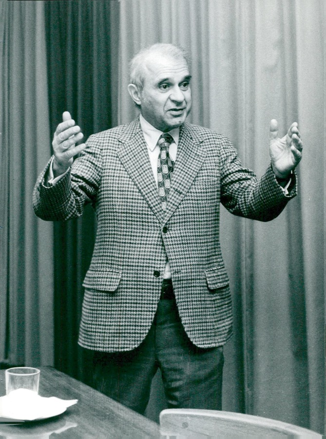
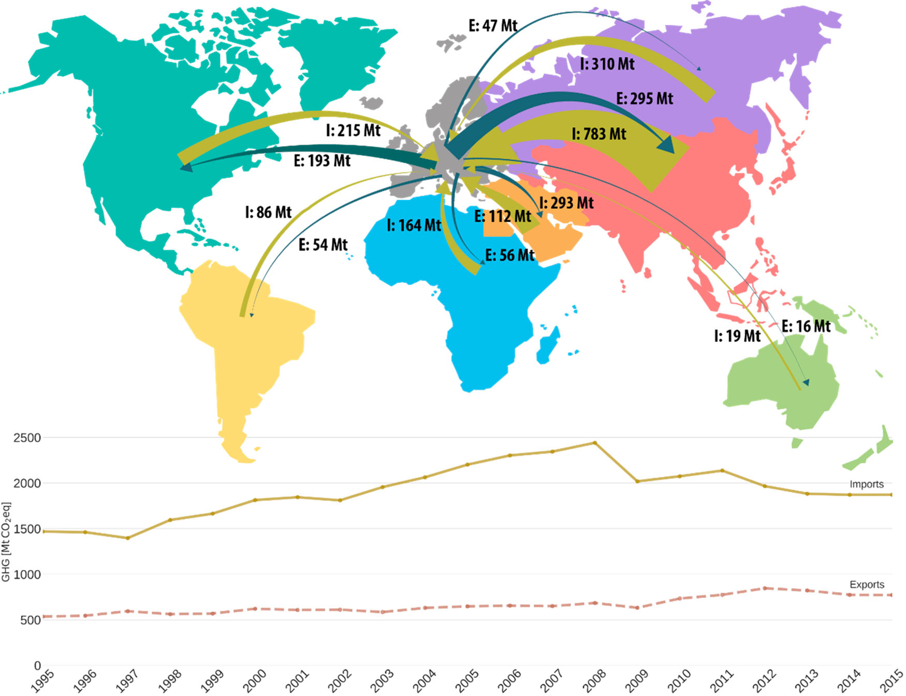

## {.duel background-color="#00395B" data-menu-title="Recap: free trade or exploitation?"}

<!-- slide 2.
     =========================================================================
     EcolEcon26 L06b — Accounting environmental stressors. HTML (revealjs)
     version of the Keynote deck EnvEcon25_T6-Environmental-IOT (PDF of the
     2025 edition, 36 slides, in _old/). The slide numbers in the comments
     below are those of that PDF. Changes follow the review in
     _old/EnvEcon25_T6-Environmental-IOT_feedback.md, up to the EU
     application (slide 27); slides 28-36 are translated unchanged.

     WHAT IS DIFFERENT FROM THE KEYNOTE
     · Recap (slides 2-6) shrunk to the quote pair from L05 plus one slide.
     · Slide 9: Schandl et al. (2017) chart replaced with our own, from the
       current IRP data (analysis/accounting_02_figures.R). Slide 10: chart
       replaced by an animated diagram (review of 27.10.).
     · Slide 8: Atlas treemaps rebuilt from Atlas data for 2024.
     · Slides 11-12 (EJAtlas, Rodrik on trade agreements) removed; the
       EJAtlas is covered in L06a.
     · Slide 16: Leontief's biography reordered, Nobel Prize and his 1970
       paper on environmental repercussions added.
     · Slides 18-21 rebuilt as inline SVG / HTML and animated.
     · New: the Leontief inverse (after slide 22), income-based accounting
       (after slide 25), MRIO uncertainty (after slide 32).
     ========================================================================= -->

::: {.duel-row .top}
::: {.duel-quote}
The ideology of "free trade" has now overplayed its hand; it has exposed
itself as a farce. With democracy about to be sacrificed on the altar of free
trade, it has become abundantly clear that free trade was never meant to be
about freedom in the first place."
:::

<figure><figcaption>Jason Hickel</figcaption></figure>
:::

::: {.duel-bolt}
<svg viewBox="0 0 40 80" aria-hidden="true"><polygon points="26,0 4,46 19,46 12,80 36,30 21,30" fill="#69AACD"/></svg>
:::

::: {.duel-row .bottom}
<figure><figcaption>Jagdish Bhagwati</figcaption></figure>

::: {.duel-quote}
[T]he various social causes that we all embrace, such as advancement of gender
equality and reduction of poverty, are advanced, not set back, by
globalization. By looking at virtually every social concern I could lay my
hands on, […] globalization, by and large, advanced these social agendas
instead of handicapping them."
:::
:::

## Recap: do countries really benefit from free trade?

- Traditional view: free trade as key source of development
  - Global division of labour: **comparative advantages**
  - Export-led growth, learning from spill-overs
- Consensus today: trade produces **winners and losers**
  - Advocates: gains > costs → potential compensation
- Since 1980s growing criticisms of free trade
- Two potential drawbacks of full free trade:
  - Technological lock-in/vicious specialisation → Session 5
  - [**Ecological externalisation → this session**]{.red}

## Motivation: externalization of ecological costs {.divider background-color="#00395B"}

::: {.secnum}
01
:::

## The vicious specialization of the Global South?

- Global South: exports of **less complex** products
  - Often more ecological harm

{.fragment height="560" fig-align="center" fig-alt="Treemaps of goods exports in 2024: African exports are dominated by crude petroleum (20%), gold (10%) and other minerals; European exports are spread over many manufactured products, the largest being cars (5%)"}

## An unequal ecological exchange?

- Physical trade balance: imports **minus** exports, in tonnes

{.fragment height="600" fig-align="center" fig-alt="Physical trade balance by world region, 1970-2024: Asia and Europe are net importers of materials; West Asia, Eastern Europe and Central Asia, Latin America, North America and Africa are net exporters"}

## Neocolonial practices?

<!-- slide 10. The material-footprint chart is replaced by a diagram (review
     of 27.10.): the chart did not show extraction, which the previous slide
     already does. One click per step of the chain. -->

::: {.columns style="gap: 1.4em; align-items: center;"}
::: {.column width="30%"}
<!-- Explicit fragment indices (reveal puts unindexed fragments last): the
     boxes come after the first bullet, bullets 2 and 3 with their step. -->
<ul><li class="fragment" data-fragment-index="1">Critical scholars: resembles <strong>Mercantilism</strong></li><li class="fragment" data-fragment-index="3">Extraction in the periphery</li><li class="fragment" data-fragment-index="4">Value added in the core</li></ul>
:::

::: {.column width="70%"}
```{=html}
<svg class="diagram neo" viewBox="0 0 900 470" width="1000" role="img" aria-label="A poorer country extracts resources and bears the ecological harm; a richer country buys them cheaply, processes them and keeps the value added; it sells the processed goods to other countries or back to the poorer country">
  <g class="fragment" data-fragment-index="2">
  <rect class="box" x="20" y="130" width="270" height="130" rx="10"/>
  <text class="boxlabel" x="155" y="172" text-anchor="middle">Poorer country</text>
  <rect class="box" x="610" y="130" width="270" height="130" rx="10"/>
  <text class="boxlabel" x="745" y="172" text-anchor="middle">Richer country</text>
  </g>
  <g class="fragment" data-fragment-index="3">
    <text class="lbl" x="155" y="212" text-anchor="middle">extracts resources</text>
    <rect class="harm" x="20" y="300" width="270" height="110" rx="10"/>
    <text class="harmt" x="155" y="340" text-anchor="middle">Ecological harm</text>
    <text class="lbl" x="155" y="372" text-anchor="middle">pollution, land use,</text>
    <text class="lbl" x="155" y="398" text-anchor="middle">water use, conflicts</text>
  </g>
  <g class="fragment draw" data-fragment-index="4">
    <path class="stroke" pathLength="1" d="M 296 160 L 588 160" fill="none" stroke="#00395B" stroke-width="6"/>
    <polygon class="head" points="0,0 -20,-11 -20,11" fill="#00395B" transform="translate(604,160)"/>
    <text x="450" y="140" text-anchor="middle" class="lbl">raw materials</text>
    <text x="450" y="192" text-anchor="middle" class="lbl-gray">cheap</text>
    <text x="745" y="212" text-anchor="middle" class="lbl">processes them</text>
    <text x="745" y="242" text-anchor="middle" class="money">value added: €€€</text>
  </g>
  <g class="fragment draw" data-fragment-index="5">
    <path class="stroke" pathLength="1" d="M 745 266 L 745 372" fill="none" stroke="#00395B" stroke-width="6"/>
    <polygon class="head" points="0,0 -20,-11 -20,11" fill="#00395B" transform="translate(745,388) rotate(90)"/>
    <rect class="head box" x="610" y="392" width="270" height="70" rx="10"/>
    <text class="boxlabel" x="745" y="435" text-anchor="middle">Other countries</text>
    <text class="lbl" x="760" y="330">processed goods</text>
  </g>
  <g class="fragment draw" data-fragment-index="6">
    <path class="stroke" pathLength="1" d="M 604 232 L 312 232" fill="none" stroke="#00395B" stroke-width="6"/>
    <polygon class="head" points="0,0 -20,-11 -20,11" fill="#00395B" transform="translate(296,232) rotate(180)"/>
    <text x="450" y="265" text-anchor="middle" class="lbl">… or back</text>
    <text x="450" y="293" text-anchor="middle" class="lbl-gray">expensive</text>
  </g>
</svg>
```
:::
:::

## Discussion in country groups

<!-- slide 13. Forward reference fixed for the 2026 schedule: conflicts are
     L06a (earlier today), global justice is Session 9. -->

::: {.columns}
::: {.column width="62%"}
- 5 minutes, in your country group:
  - What do you know about 'unequal' ecological exchange?
  - Normative assessment?
  - Your central questions?
- No final answer needed
  - Later: how to quantify these flows
:::

::: {.column .qrcol width="38%"}


::: {#discussion-timer .timer .timer-sm seconds="300" starton="interaction"}
:::
:::
:::

## Accounting environmental stressors {.divider background-color="#00395B"}

::: {.secnum}
02
:::

## Learning goals and outline

<!-- slide 15 -->

::: {.columns .divided .goals .nonincremental}
::: {.column width="55%"}
### Learning goals

::: {.upper-roman}
I.  Understand the basic construction of **input-output tables** and what they can be used for
II. Learn about different ways to account for environmental damages, especially: **production-based** vs. **consumption-based** accounting
III. Know where to get input-output-based **data** for specific country analyses
:::
:::

::: {.column width="45%"}
### Outline

::: {.upper-roman}
I.  Accounting for environmental stressors: basics of input-output analysis
II. An example: carbon accounting and the EU footprint
III. Exercises and group work
:::
:::
:::

## Input-Output Analysis

<!-- slide 16. Biography put in order, Nobel Prize and the 1970 paper added
     (review §5). Leontief was born in Munich in 1905 and grew up in
     St Petersburg; he left the Soviet Union in 1925 for Berlin (PhD 1928),
     worked at the Kiel Institute and emigrated to the USA in 1931. -->

<!-- The portrait sits inside the "Developed by" bullet, so that both appear
     on the same click, and is lifted out of the flow to the right (.rel /
     .abs-right, see euf-slides.scss). -->

::: {.rel}
::: {style="width: 74%;"}
- Quantifying environmental stressors: difficult, especially globally
- Common tool: environmentally-augmented **input-output tables** (EA-IOT)
- Input-output table (IOT): a **table** of…
  - …the **economic flows between industries** within a region
  - …from raw material extraction to final consumption
- Developed by **Wassily W. Leontief** [{width="250" alt="Wassily Leontief"}<br>Wassily Leontief<br>(1905-1999)]{.abs-right .portrait style="top: 0; width: 24%; text-align: center; display: block;"}
  - Born in Munich, grew up and studied in Petrograd/Leningrad; resisted the oppression of academic autonomy and freedom
  - 1925 to Germany, 1931 to the USA
  - **Nobel Prize** 1973 for the input-output method
  - Applied to the environment as early as 1970 [@leontief1970]
:::
:::

## Input-Output Analysis

<!-- slide 17. The source of the quote was missing on the slide. -->

- Key motivation: aligning economics closely to actual accounting

::: {.columns .fragment .bigquote style="align-items: center; gap: 1.6em; margin: 0.6em 0 0.8em 0;"}
::: {.column width="70%"}
> Page after page of professional economic journals are filled with
> mathematical formulas leading the reader from sets of more or less plausible
> but entirely arbitrary assumptions to precisely stated but irrelevant
> theoretical conclusions. [@leontief1982, 104]
:::

::: {.column width="30%"}
{width="300" alt="Wassily Leontief lecturing"}
:::
:::

- Data source: statistical offices directly
- Only very simple *economic* theory involved

## An input-output table: the complete view

<!-- slide 18. The Miller & Blair figure redrawn; each question arrow is drawn
     on its own click and highlights the part of the table it is about:
     a column (inputs), a row (outputs), final demand, value added. -->

<svg class="diagram iot" viewBox="0 0 1440 600" width="1440" role="img" aria-label="Input-output transactions table: industries as producers and as consumers, final demand, and value added">
<rect class="cell cz" x="410" y="180" width="66" height="27"/>
<rect class="cell cz" x="476" y="180" width="66" height="27"/>
<rect class="cell cz" x="542" y="180" width="66" height="27"/>
<rect class="cell cz" x="608" y="180" width="66" height="27"/>
<rect class="cell cz" x="674" y="180" width="66" height="27"/>
<rect class="cell cz" x="740" y="180" width="66" height="27"/>
<rect class="cell cz" x="806" y="180" width="66" height="27"/>
<rect class="cell cz" x="872" y="180" width="66" height="27"/>
<rect class="cell cf" x="938" y="180" width="86" height="27"/>
<rect class="cell cf" x="1024" y="180" width="86" height="27"/>
<rect class="cell cf" x="1110" y="180" width="86" height="27"/>
<rect class="cell cf" x="1196" y="180" width="86" height="27"/>
<rect class="cell cz" x="410" y="207" width="66" height="27"/>
<rect class="cell cz" x="476" y="207" width="66" height="27"/>
<rect class="cell cz" x="542" y="207" width="66" height="27"/>
<rect class="cell cz" x="608" y="207" width="66" height="27"/>
<rect class="cell cz" x="674" y="207" width="66" height="27"/>
<rect class="cell cz" x="740" y="207" width="66" height="27"/>
<rect class="cell cz" x="806" y="207" width="66" height="27"/>
<rect class="cell cz" x="872" y="207" width="66" height="27"/>
<rect class="cell cf" x="938" y="207" width="86" height="27"/>
<rect class="cell cf" x="1024" y="207" width="86" height="27"/>
<rect class="cell cf" x="1110" y="207" width="86" height="27"/>
<rect class="cell cf" x="1196" y="207" width="86" height="27"/>
<rect class="cell cz" x="410" y="234" width="66" height="27"/>
<rect class="cell cz" x="476" y="234" width="66" height="27"/>
<rect class="cell cz" x="542" y="234" width="66" height="27"/>
<rect class="cell cz" x="608" y="234" width="66" height="27"/>
<rect class="cell cz" x="674" y="234" width="66" height="27"/>
<rect class="cell cz" x="740" y="234" width="66" height="27"/>
<rect class="cell cz" x="806" y="234" width="66" height="27"/>
<rect class="cell cz" x="872" y="234" width="66" height="27"/>
<rect class="cell cf" x="938" y="234" width="86" height="27"/>
<rect class="cell cf" x="1024" y="234" width="86" height="27"/>
<rect class="cell cf" x="1110" y="234" width="86" height="27"/>
<rect class="cell cf" x="1196" y="234" width="86" height="27"/>
<rect class="cell cz" x="410" y="261" width="66" height="27"/>
<rect class="cell cz" x="476" y="261" width="66" height="27"/>
<rect class="cell cz" x="542" y="261" width="66" height="27"/>
<rect class="cell cz" x="608" y="261" width="66" height="27"/>
<rect class="cell cz" x="674" y="261" width="66" height="27"/>
<rect class="cell cz" x="740" y="261" width="66" height="27"/>
<rect class="cell cz" x="806" y="261" width="66" height="27"/>
<rect class="cell cz" x="872" y="261" width="66" height="27"/>
<rect class="cell cf" x="938" y="261" width="86" height="27"/>
<rect class="cell cf" x="1024" y="261" width="86" height="27"/>
<rect class="cell cf" x="1110" y="261" width="86" height="27"/>
<rect class="cell cf" x="1196" y="261" width="86" height="27"/>
<rect class="cell cz" x="410" y="288" width="66" height="27"/>
<rect class="cell cz" x="476" y="288" width="66" height="27"/>
<rect class="cell cz" x="542" y="288" width="66" height="27"/>
<rect class="cell cz" x="608" y="288" width="66" height="27"/>
<rect class="cell cz" x="674" y="288" width="66" height="27"/>
<rect class="cell cz" x="740" y="288" width="66" height="27"/>
<rect class="cell cz" x="806" y="288" width="66" height="27"/>
<rect class="cell cz" x="872" y="288" width="66" height="27"/>
<rect class="cell cf" x="938" y="288" width="86" height="27"/>
<rect class="cell cf" x="1024" y="288" width="86" height="27"/>
<rect class="cell cf" x="1110" y="288" width="86" height="27"/>
<rect class="cell cf" x="1196" y="288" width="86" height="27"/>
<rect class="cell cz" x="410" y="315" width="66" height="27"/>
<rect class="cell cz" x="476" y="315" width="66" height="27"/>
<rect class="cell cz" x="542" y="315" width="66" height="27"/>
<rect class="cell cz" x="608" y="315" width="66" height="27"/>
<rect class="cell cz" x="674" y="315" width="66" height="27"/>
<rect class="cell cz" x="740" y="315" width="66" height="27"/>
<rect class="cell cz" x="806" y="315" width="66" height="27"/>
<rect class="cell cz" x="872" y="315" width="66" height="27"/>
<rect class="cell cf" x="938" y="315" width="86" height="27"/>
<rect class="cell cf" x="1024" y="315" width="86" height="27"/>
<rect class="cell cf" x="1110" y="315" width="86" height="27"/>
<rect class="cell cf" x="1196" y="315" width="86" height="27"/>
<rect class="cell cz" x="410" y="342" width="66" height="27"/>
<rect class="cell cz" x="476" y="342" width="66" height="27"/>
<rect class="cell cz" x="542" y="342" width="66" height="27"/>
<rect class="cell cz" x="608" y="342" width="66" height="27"/>
<rect class="cell cz" x="674" y="342" width="66" height="27"/>
<rect class="cell cz" x="740" y="342" width="66" height="27"/>
<rect class="cell cz" x="806" y="342" width="66" height="27"/>
<rect class="cell cz" x="872" y="342" width="66" height="27"/>
<rect class="cell cf" x="938" y="342" width="86" height="27"/>
<rect class="cell cf" x="1024" y="342" width="86" height="27"/>
<rect class="cell cf" x="1110" y="342" width="86" height="27"/>
<rect class="cell cf" x="1196" y="342" width="86" height="27"/>
<rect class="cell cz" x="410" y="369" width="66" height="27"/>
<rect class="cell cz" x="476" y="369" width="66" height="27"/>
<rect class="cell cz" x="542" y="369" width="66" height="27"/>
<rect class="cell cz" x="608" y="369" width="66" height="27"/>
<rect class="cell cz" x="674" y="369" width="66" height="27"/>
<rect class="cell cz" x="740" y="369" width="66" height="27"/>
<rect class="cell cz" x="806" y="369" width="66" height="27"/>
<rect class="cell cz" x="872" y="369" width="66" height="27"/>
<rect class="cell cf" x="938" y="369" width="86" height="27"/>
<rect class="cell cf" x="1024" y="369" width="86" height="27"/>
<rect class="cell cf" x="1110" y="369" width="86" height="27"/>
<rect class="cell cf" x="1196" y="369" width="86" height="27"/>
<rect class="cell cv" x="410" y="396" width="528" height="31"/>
<text class="va" x="674.0" y="418" text-anchor="middle">Employee compensation</text>
<rect class="cell cv" x="410" y="427" width="528" height="31"/>
<text class="va" x="674.0" y="449" text-anchor="middle">Profit-type income and capital consumption allowances</text>
<rect class="cell cv" x="410" y="458" width="528" height="31"/>
<text class="va" x="674.0" y="480" text-anchor="middle">Indirect business taxes</text>
<rect class="cell cv" x="938" y="396" width="344" height="93"/>
<text class="va" x="1110.0" y="447.5" text-anchor="middle">GROSS DOMESTIC PRODUCT</text>
<rect class="frame" x="410" y="180" width="528" height="216"/>
<rect class="frame" x="938" y="180" width="344" height="216"/>
<rect class="frame" x="410" y="396" width="872" height="93"/>
<text class="hd" x="674.0" y="128" text-anchor="middle">PRODUCERS AS CONSUMERS</text>
<text class="hd" x="1110.0" y="128" text-anchor="middle">FINAL DEMAND</text>
<text class="ch" x="443.0" y="170" text-anchor="middle">Agric.</text>
<text class="ch" x="509.0" y="170" text-anchor="middle">Mining</text>
<text class="ch" x="575.0" y="170" text-anchor="middle">Constr.</text>
<text class="ch" x="641.0" y="170" text-anchor="middle">Manuf.</text>
<text class="ch" x="707.0" y="170" text-anchor="middle">Trade</text>
<text class="ch" x="773.0" y="170" text-anchor="middle">Transp.</text>
<text class="ch" x="839.0" y="170" text-anchor="middle">Services</text>
<text class="ch" x="905.0" y="170" text-anchor="middle">Other</text>
<text class="ch" x="981.0" y="152" text-anchor="middle">Household</text>
<text class="ch" x="981.0" y="170" text-anchor="middle">consumption</text>
<text class="ch" x="1067.0" y="152" text-anchor="middle">Invest-</text>
<text class="ch" x="1067.0" y="170" text-anchor="middle">ment</text>
<text class="ch" x="1153.0" y="152" text-anchor="middle">Govern-</text>
<text class="ch" x="1153.0" y="170" text-anchor="middle">ment</text>
<text class="ch" x="1239.0" y="152" text-anchor="middle">Net</text>
<text class="ch" x="1239.0" y="170" text-anchor="middle">exports</text>
<text class="rl" x="402" y="200" text-anchor="end">Agriculture</text>
<text class="rl" x="402" y="227" text-anchor="end">Mining</text>
<text class="rl" x="402" y="254" text-anchor="end">Construction</text>
<text class="rl" x="402" y="281" text-anchor="end">Manufacturing</text>
<text class="rl" x="402" y="308" text-anchor="end">Trade</text>
<text class="rl" x="402" y="335" text-anchor="end">Transportation</text>
<text class="rl" x="402" y="362" text-anchor="end">Services</text>
<text class="rl" x="402" y="389" text-anchor="end">Other industry</text>
<text class="rl" x="402" y="418" text-anchor="end">Employees</text>
<text class="rl" x="402" y="449" text-anchor="end">Business owners & capital</text>
<text class="rl" x="402" y="480" text-anchor="end">Government</text>
<text class="hd" x="402" y="170" text-anchor="end">PRODUCERS</text>
<text class="hd" x="402" y="509" text-anchor="end">VALUE ADDED</text>
<g class="fragment draw"><path class="stroke" pathLength="1" d="M 641.0 6 L 641.0 64" fill="none" stroke="#DF5541" stroke-width="9"/><polygon class="head" points="0,0 -24,-16 -24,16" fill="#DF5541" transform="translate(641.0,82) rotate(90)"/><rect class="head hlr" x="608" y="180" width="66" height="309"/><text class="q" x="594" y="26" text-anchor="end">Where do inputs come from?</text><text class="qs" x="663.0" y="26">Composition of inputs required to produce output</text></g>
<g class="fragment draw"><path class="stroke" pathLength="1" d="M 10 274.5 L 200 274.5" fill="none" stroke="#DF5541" stroke-width="9"/><polygon class="head" points="0,0 -24,-16 -24,16" fill="#DF5541" transform="translate(218,274.5) rotate(0)"/><rect class="head hlr" x="410" y="261" width="872" height="27"/><text class="q" x="10" y="250.5">Where do things go?</text><text class="qs" x="10" y="314.5">Distribution of</text><text class="qs" x="10" y="334.5">producers' output</text><text class="qs" x="10" y="354.5">through the economy</text></g>
<g class="fragment draw"><path class="stroke" pathLength="1" d="M 1436 288.0 L 1328 288.0" fill="none" stroke="#5FB46E" stroke-width="9"/><polygon class="head" points="0,0 -24,-16 -24,16" fill="#5FB46E" transform="translate(1310,288.0) rotate(180)"/><text class="qs" x="1302" y="248.0">Sales to final</text><text class="qs" x="1302" y="268.0">markets</text><path class="stroke then" pathLength="1" d="M 1288 174 H 938 V 396 H 1288 Z" fill="none" stroke="#5FB46E" stroke-width="4"/></g>
<g class="fragment draw"><path class="stroke" pathLength="1" d="M 470 596 L 470 535" fill="none" stroke="#2A72B5" stroke-width="9"/><polygon class="head" points="0,0 -24,-16 -24,16" fill="#2A72B5" transform="translate(470,517) rotate(-90)"/><text class="qs" x="500" y="551">Non-industrial inputs to production</text><path class="stroke then" pathLength="1" d="M 404 495 V 390 H 1288 V 495 Z" fill="none" stroke="#2A72B5" stroke-width="4"/></g>
<g class="fragment"><rect class="exc" x="608" y="207" width="66" height="27"/><text class="exn" x="641.0" y="227" text-anchor="middle">120</text><rect class="exbox" x="938" y="507" width="498" height="84" rx="6"/><text class="exn" x="954" y="537">120</text><text class="ext" x="1004" y="537">in the row Mining, column Manuf.:</text><text class="ext" x="954" y="569">manufacturers buy €120 bn of mining products</text></g>
</svg>

::: {.source}
After Miller & Blair [-@miller2009, fig. 1.1].
:::

## Input-output tables in more detail

<!-- slide 19. "Missing of this" → "Missing from this" (review §5). The cell
     z_ij lights up with the first bullet, the whole row i with the last. -->

::: {.columns style="gap: 1.6em;"}
::: {.column width="44%"}
[Interindustry flows of goods]{.muted}

<table class="econ io" style="margin-top: 0.4em; font-size: 0.85em;">
<thead>
<tr><th class="blank"></th><th colspan="5">Buying sector</th></tr>
<tr><th>Selling sector</th><th>1</th><th>⋯</th><th><i>j</i></th><th>⋯</th><th><i>n</i></th></tr>
</thead>
<tbody>
<tr><td>1</td><td><i>z</i><sub>11</sub></td><td>⋯</td><td><i>z</i><sub>1<i>j</i></sub></td><td>⋯</td><td><i>z</i><sub>1<i>n</i></sub></td></tr>
<tr><td>⋮</td><td>⋮</td><td></td><td>⋮</td><td></td><td>⋮</td></tr>
<tr><td class="fragment mark mr" data-fragment-index="4"><i>i</i></td><td class="fragment mark mf" data-fragment-index="4"><i>z</i><sub><i>i</i>1</sub></td><td class="fragment mark mf" data-fragment-index="4">⋯</td><td class="fragment mark mr" data-fragment-index="1"><i>z</i><sub><i>ij</i></sub></td><td class="fragment mark mf" data-fragment-index="4">⋯</td><td class="fragment mark mf" data-fragment-index="4"><i>z</i><sub><i>in</i></sub></td></tr>
<tr><td>⋮</td><td>⋮</td><td></td><td>⋮</td><td></td><td>⋮</td></tr>
<tr><td><i>n</i></td><td><i>z</i><sub><i>n</i>1</sub></td><td>⋯</td><td><i>z</i><sub><i>nj</i></sub></td><td>⋯</td><td><i>z</i><sub><i>nn</i></sub></td></tr>
</tbody>
</table>

::: {.fragment fragment-index=5 style="margin-top: 1.4em;"}
- Next: embed this table in the full national accounts
:::
:::

::: {.column width="56%"}
::: {.nonincremental}
::: {.fragment fragment-index=1}
- $z_{ij}$: sales of sector $i$ to sector $j$ (interindustry sales)
:::

::: {.fragment fragment-index=2}
- Total matrix for country $k$:
  $$Z_{kk} = \begin{pmatrix} z_{11} & \cdots & z_{1n} \\ \vdots & & \vdots \\ z_{n1} & \cdots & z_{nn} \end{pmatrix}$$
:::

::: {.fragment fragment-index=3}
- Missing: sales to non-industry actors, $f_i$
:::

::: {.fragment fragment-index=4}
- Total sales of sector $i$, $x_i$:
  $$x_i = z_{i1} + \dots + z_{ij} + \dots + z_{in} + f_i = \sum_{j=1}^n z_{ij} + f_i$$
:::
:::
:::
:::

::: {.source}
Miller & Blair [-@miller2009, ch. 2].
:::

## Full accounts for a two-sector economy

<!-- slide 20. The colour blocks of the Keynote now light up one after the
     other, each with its explanation: final demand, value added, totals
     (review §5: "work with animations"). -->

<table class="econ io io2">
<thead><tr><th class="blank" colspan="2"></th><th colspan="2" class="z">Processing sectors</th><th colspan="4">Final demand</th><th>Total output (<i>x</i>)</th></tr><tr><th class="blank" colspan="2"></th><th class="z">1</th><th class="z">2</th><th>C</th><th>I</th><th>G</th><th>E</th><th></th></tr></thead><tbody>
<tr><td class="rowlab" rowspan="2">Processing sectors</td><td>1</td><td class="z"><i>z</i><sub>11</sub></td><td class="z"><i>z</i><sub>12</sub></td><td class="fragment mark mf" data-fragment-index="1"><i>c</i><sub>1</sub></td><td class="fragment mark mf" data-fragment-index="1"><i>i</i><sub>1</sub></td><td class="fragment mark mf" data-fragment-index="1"><i>g</i><sub>1</sub></td><td class="fragment mark mf" data-fragment-index="1"><i>e</i><sub>1</sub></td><td class="fragment mark mx" data-fragment-index="3"><i>x</i><sub>1</sub></td></tr>
<tr><td>2</td><td class="z"><i>z</i><sub>21</sub></td><td class="z"><i>z</i><sub>22</sub></td><td class="fragment mark mf" data-fragment-index="1"><i>c</i><sub>2</sub></td><td class="fragment mark mf" data-fragment-index="1"><i>i</i><sub>2</sub></td><td class="fragment mark mf" data-fragment-index="1"><i>g</i><sub>2</sub></td><td class="fragment mark mf" data-fragment-index="1"><i>e</i><sub>2</sub></td><td class="fragment mark mx" data-fragment-index="3"><i>x</i><sub>2</sub></td></tr>
<tr><td class="rowlab" rowspan="3">Payments sectors</td><td class="rowlab">Value added (<i>v</i>′)</td><td class="fragment mark mv" data-fragment-index="2"><i>l</i><sub>1</sub></td><td class="fragment mark mv" data-fragment-index="2"><i>l</i><sub>2</sub></td><td><i>l</i><sub>C</sub></td><td><i>l</i><sub>I</sub></td><td><i>l</i><sub>G</sub></td><td><i>l</i><sub>E</sub></td><td class="fragment mark mx" data-fragment-index="3"><i>L</i></td></tr>
<tr><td class="rowlab"></td><td class="fragment mark mv" data-fragment-index="2"><i>n</i><sub>1</sub></td><td class="fragment mark mv" data-fragment-index="2"><i>n</i><sub>2</sub></td><td><i>n</i><sub>C</sub></td><td><i>n</i><sub>I</sub></td><td><i>n</i><sub>G</sub></td><td><i>n</i><sub>E</sub></td><td class="fragment mark mx" data-fragment-index="3"><i>N</i></td></tr>
<tr><td class="rowlab">Imports</td><td class="fragment mark mv" data-fragment-index="2"><i>m</i><sub>1</sub></td><td class="fragment mark mv" data-fragment-index="2"><i>m</i><sub>2</sub></td><td><i>m</i><sub>C</sub></td><td><i>m</i><sub>I</sub></td><td><i>m</i><sub>G</sub></td><td><i>m</i><sub>E</sub></td><td class="fragment mark mx" data-fragment-index="3"><i>M</i></td></tr>
<tr><td class="rowlab" colspan="2">Total outlays (<i>x</i>′)</td><td class="fragment mark mx" data-fragment-index="3"><i>x</i><sub>1</sub></td><td class="fragment mark mx" data-fragment-index="3"><i>x</i><sub>2</sub></td><td class="fragment mark mx" data-fragment-index="3"><i>C</i></td><td class="fragment mark mx" data-fragment-index="3"><i>I</i></td><td class="fragment mark mx" data-fragment-index="3"><i>G</i></td><td class="fragment mark mx" data-fragment-index="3"><i>E</i></td><td class="fragment mark mx" data-fragment-index="3"><i>X</i></td></tr>
</tbody></table>

::: {.grid3 .io-notes .nonincremental}
::: {.cap .nf .fragment fragment-index=1}
**Composition of final demand**

- consumption $C$, investment $I$, government spending $G$ and exports $E$
- $f_i = c_i + i_i + g_i + e_i$
:::

::: {.cap .nv .fragment fragment-index=2}
**The pendant on the input side: payments sectors / value added**

- Employees' (non-industrial) labor: $l_i$
- Other value added, e.g. government services, capital, land: $n_i$
- Total value-added payments: $v_i = l_i + n_i$
:::

::: {.cap .nx .fragment fragment-index=3}
**Totals**

- Sum of columns or rows: total gross output $X$
- Unlike net output (GDP): includes intermediate production
:::
:::

::: {.source}
Miller & Blair [-@miller2009, table 2.2].
:::

## More than one country: MRIO tables

<!-- slide 21. The two blocks of Z are opened one at a time, in the colours
     of the Keynote: domestic (red), trade (blue). -->

- Global perspective: more than one country → system of IO tables
  - **Multi-regional input-output (MRIO)** tables
- All relevant matrices extended, e.g.:

::: {.mrio .nonincremental}
::: {.blk .fragment}
$$Z =\begin{pmatrix} Z_{11} & \cdots & \color{#2A72B5}{Z_{1k}} \\ \vdots & & \vdots \\ Z_{k1} & \cdots & \color{#DF5541}{Z_{kk}} \end{pmatrix}$$
:::

::: {.blk .dom .fragment}
$$Z_{kk} = \begin{pmatrix} z_{11} & \cdots & z_{1n} \\ \vdots & & \vdots \\ z_{n1} & \cdots & z_{nn} \end{pmatrix}$$
[Domestic inter-industry flows]{.lab}
:::

::: {.blk .trd .fragment}
$$Z_{1k} = \begin{pmatrix} z_{11} & \cdots & z_{1n} \\ \vdots & & \vdots \\ z_{n1} & \cdots & z_{nn} \end{pmatrix}$$
[Inter-industry trade flows (here: region 1 to region *k*)]{.lab}
:::
:::

- Allows computing total requirements or **footprints**:
  - Inputs **from home and abroad** for *domestic* demand

## Input-output tables and the environment

<!-- slide 22 -->

- IO tables: tracking flows of goods throughout production
- Classical IO tables ignore the environment:
  - Goods taken from nature…
  - …stressors thrown back into the environment
- Adding this → **environmentally-extended multi-regional input-output (EE MRIO)** tables
  - Different ways to add environmental information
  - E.g., environmental factors as commodities of their own
- Result: damages in country $i$ caused by consumption and production in country $j$

## From flows to footprints: the Leontief inverse

<!-- NEW (review §2). Four steps, one per click; in step 3 the series is
     built term by term — "the requirements of the requirements". -->

::: {.nonincremental}
::: {.fragment}
- **Technical coefficients**: inputs from $i$ per unit of output of $j$: $\;a_{ij} = z_{ij} / x_j$, i.e. $\;A = Z\hat{x}^{-1}$

  [Example: car industry, output €100 bn, buys steel for €20 bn → $a_{\text{steel,cars}} = 0.2$, i.e. 20 cents of steel per € of cars]{.example}
:::

::: {.fragment}
- Output = what industries need + what final users buy: $\;x = Ax + f \;\Rightarrow\; x = (I - A)^{-1} f$

  [Example, one sector with $a = 0.2$: final demand $f = 100$ → output $x = 100 / (1 - 0.2) = 125 = 100 + 20 + 4 + 0.8 + \dots$]{.example}
:::

::: {.fragment}
- What the **Leontief inverse** $(I-A)^{-1}$ contains:
:::
:::

::: {.series}
::: {.term .fragment}
$(I-A)^{-1} =$
:::

::: {.term .fragment}
$I$
[the final product itself]{.lab}
:::

::: {.op .fragment}
$+$
:::

::: {.term .fragment}
$A$
[direct inputs]{.lab}
:::

::: {.op .fragment}
$+$
:::

::: {.term .fragment}
$A^2$
[inputs of the inputs]{.lab}
:::

::: {.op .fragment}
$+$
:::

::: {.term .fragment}
$A^3 + \dots$
[and so on, up the<br>supply chain]{.lab}
:::
:::

::: {.keybox .fragment style="margin-top: 1.0em;"}
::: {.eqlab}
::: {.term}
footprint $=$
:::

::: {.term}
$s$
[stressor per unit of output<br>(e.g. t CO₂ per €)]{.lab}
:::

::: {.term}
$(I-A)^{-1}$
[the whole<br>supply chain]{.lab}
:::

::: {.term}
$f$
[final demand]{.lab}
:::
:::
:::

::: {.source}
Miller & Blair [-@miller2009, ch. 2 and 13]; Leontief [-@leontief1970].
:::

## A real-world example: EXIOBASE3

<!-- slide 23. Years updated (review §5): v3.11.2 (Zenodo, Sept. 2026) runs
     1995-2024, with the most recent years nowcast. The concept DOI always
     resolves to the latest release. -->

::: {.columns style="align-items: center;"}
::: {.column width="64%"}
- Prominent EE MRIO table: **EXIOBASE3**
  - 44 countries + five rest-of-the-world regions, 1995–2024 (most recent years nowcast)
:::

::: {.column width="36%"}
{width="100%" alt="EXIOBASE"}
:::
:::

- 163 industries, 200 products, and detailed environmental accounts
  - 60 primary and secondary energy sources for national energy supply
  - 27 pollutants, about 40 different water uses, about 300 material flows, etc.
- Construction started in 2007 (EXIOBASE1: 2011)
- Many results available online
- More detailed analysis → process the data yourself, e.g. in Python: [one-page tutorial](https://ecological-economics26.netlify.app/content/material/exiobase_python.html)

::: {.source}
Stadler et al. [-@stadler2018]; current release on [Zenodo](https://doi.org/10.5281/zenodo.3583070).
:::

## Consumption & Production-based accounting

<!-- slide 24 -->

- Goal: environmental impact of consumption and production
  - **Two (basic) approaches**, many intermediate variations^[See Tukker et al. [-@tukker2020] for an overview.]

<!-- Both boxes on one click (one fragment around the row of boxes), then
     the bullets under them. -->

::: {.columns .fragment style="gap: 2.4em; margin-top: 0.6em;"}
::: {.column width="50%"}
::: {.keybox style="width: 100%; box-sizing: border-box; margin: 0;"}
**Production-based accounting (PBA)**
:::
:::

::: {.column width="50%"}
::: {.keybox style="width: 100%; box-sizing: border-box; margin: 0;"}
**Consumption-based accounting (CBA)**
:::
:::
:::

::: {.columns style="gap: 2.4em; margin-top: 0.6em;"}
::: {.column width="50%"}
- The "**polluter pays**" principle
- Emissions counted where extraction/production takes place
:::

::: {.column width="50%"}
- The "**user pays**" principle
- Emissions counted where the final product is consumed
:::
:::

## CBA and PBA: an example {auto-animate="true" data-auto-animate-id="car"}

<!-- slide 25. The value chain first, bullet by bullet; then the table; then
     one cell per click, the PBA column before the CBA column — the contrast is
     the point of the slide. All fragments carry explicit indices (reveal puts
     unindexed fragments last), hence the raw <ul> in the chain. Auto-animates
     into the next slide, which adds the third column. -->

::: {.nonincremental}
- Example of a three-step value chain:
:::

::: {.columns style="gap: 2.4em; align-items: center;"}
::: {.column width="38%"}
::: {.chain}
::: {.link .chn}
[China]{.who}

<ul><li class="fragment" data-fragment-index="1">Rare earth elements extracted</li><li class="fragment" data-fragment-index="2">Basic material for car parts produced</li></ul>
:::

::: {.link .pol}
[Poland]{.who}

<ul><li class="fragment" data-fragment-index="3">Final car components produced</li></ul>
:::

::: {.link .ger}
[Germany]{.who}

<ul><li class="fragment" data-fragment-index="4">Car assembled</li><li class="fragment" data-fragment-index="5">Car sold to final customer</li></ul>
:::
:::
:::

::: {.column width="62%"}
<table class="econ acct fragment" data-id="car-table" data-fragment-index="6">
<thead><tr><th></th><th>PBA</th><th>CBA</th></tr></thead>
<tbody>
<tr><td>Extraction of rare earth elements</td><td class="fragment CHN" data-fragment-index="7">CHN</td><td class="fragment GER" data-fragment-index="11">GER</td></tr>
<tr><td>Production of basic material</td><td class="fragment CHN" data-fragment-index="8">CHN</td><td class="fragment GER" data-fragment-index="12">GER</td></tr>
<tr><td>Production of final car components</td><td class="fragment POL" data-fragment-index="9">POL</td><td class="fragment GER" data-fragment-index="13">GER</td></tr>
<tr><td>Car assembly and selling process</td><td class="fragment GER" data-fragment-index="10">GER</td><td class="fragment GER" data-fragment-index="14">GER</td></tr>
</tbody>
</table>
:::
:::

## A third perspective: who earns from the emissions? {auto-animate="true" data-auto-animate-id="car"}

<!-- NEW (review §4). Income-based accounting (Marques et al. 2012), as one
     of the "multiple accounts" of Steininger et al. (2016): emissions are
     allocated to everyone whose value added they enable — the emitting
     stage and every stage downstream of it, in proportion to the value
     added each earns. Hence the split cells. -->

::: {.columns style="gap: 2.4em; align-items: center;"}
::: {.column width="38%"}
<!-- Bullets 1-2, then the IBA column cell by cell, then bullet 3. -->
<ul><li class="fragment" data-fragment-index="1"><strong>Income-based accounting (IBA)</strong>: the “<strong>who earns</strong>” principle</li><li class="fragment" data-fragment-index="2">Emissions allocated to those earning the <strong>value added</strong> they enable, <em>downstream</em> of the emission</li><li class="fragment" data-fragment-index="7">Not a technicality: a question of <strong>responsibility</strong> → Session 9</li></ul>
:::

::: {.column width="62%"}
<table class="econ acct" data-id="car-table">
<thead><tr><th></th><th>PBA</th><th>CBA</th><th class="fragment" data-fragment-index="3">IBA</th></tr></thead>
<tbody>
<tr><td>Extraction of rare earth elements</td><td class="CHN">CHN</td><td class="GER">GER</td><td class="fragment mix" data-fragment-index="3">CHN · POL · GER</td></tr>
<tr><td>Production of basic material</td><td class="CHN">CHN</td><td class="GER">GER</td><td class="fragment mix" data-fragment-index="4">CHN · POL · GER</td></tr>
<tr><td>Production of final car components</td><td class="POL">POL</td><td class="GER">GER</td><td class="fragment mix2" data-fragment-index="5">POL · GER</td></tr>
<tr><td>Car assembly and selling process</td><td class="GER">GER</td><td class="GER">GER</td><td class="fragment GER" data-fragment-index="6">GER</td></tr>
</tbody>
</table>
:::
:::

::: {.source}
Steininger et al. [-@steininger2016]; Marques et al. [-@marques2012]. IBA cells: split by each country's share in the value added.
:::

## Group work

<!-- slide 26, doubled words removed (review §5). Shared via Tweedback
     (review of 27.10.: QR code on the group-work slides); in 2025 via the
     Moodle forum. -->

::: {.columns}
::: {.column width="60%"}
- In your group: which approach – CBA or PBA – is…
  - …fairer?
  - …more practical?
  - …more relevant?
- Share your thoughts on **Tweedback**
- Post your open questions, too!

::: {#groupwork-timer .timer seconds="600" starton="interaction"}
:::
:::

::: {.column .qrcol width="40%"}


:::
:::

## Example application {.divider background-color="#00395B"}

::: {.secnum}
03
:::

## The European carbon footprint

<!-- slide 28. Slides 28-32: one title each instead of title + subhead
     (review of 27.10.). -->

- Wood et al. [-@wood2020]: EU28 carbon footprint with EXIOBASE3

::: {.columns style="gap: 1.6em;"}
::: {.column width="60%"}
{height="540" alt="GHG emissions embodied in EU trade: flows with other world regions in 2015, and total traded emissions 1995-2015"}
:::

::: {.column width="40%"}
- EU28 strongly integrated into world trade
- EU28: net emission importer
- Externalisation decreasing since 2008
- Main reason: technological improvements in the EU and abroad
:::
:::

::: {.source}
Source: Wood et al. [-@wood2020], fig. 3.
:::

## Emissions embodied in EU trade

<!-- slide 29 -->

- **Emissions embodied in imports** (EEI): emitted outside the EU28 for final demand *within* the EU28 ('externalised')
  - Non-CO₂ gases: net trade 40% of total footprint
  - CO₂: EEI only 15% → trade in mining (CH₄), food and agriculture (CH₄, N₂O)
- In all: 33% of the EU footprint due to EEI
  - 17% of the EU's PBA emissions embodied in *exports*

::: {.arrowkey .fragment}
::: {.bigarrow style="color: #00395B;"}
➡
:::

::: {.keybox}
Domestic policies miss 33% of emissions caused
:::
:::

## What drives the EU footprint?

<!-- slide 30. The three drivers are drawn one at a time; each badge says
     the sign of its effect on the footprint. -->

```{=html}
<svg class="diagram" viewBox="0 0 960 350" width="1250" role="img" aria-label="Three drivers of the EU footprint: composition of trade, population growth and consumption per capita (no net effect); production technologies (negative); level of trade and total consumption (positive)">
  <rect class="box" x="320" y="145" width="320" height="70" rx="10"/>
  <text class="boxlabel" x="480" y="188" text-anchor="middle">Overall footprint</text>
  <rect class="box" x="5" y="5" width="410" height="90" rx="10"/>
  <text class="boxlabel" x="210" y="42" text-anchor="middle">Composition of trade, population</text>
  <text class="boxlabel" x="210" y="74" text-anchor="middle">growth, consumption per capita</text>
  <rect class="box" x="600" y="15" width="355" height="70" rx="10"/>
  <text class="boxlabel" x="777" y="58" text-anchor="middle">Production technologies</text>
  <rect class="box" x="300" y="265" width="360" height="82" rx="10"/>
  <text class="boxlabel" x="480" y="298" text-anchor="middle">Level of trade &amp; total</text>
  <text class="boxlabel" x="480" y="328" text-anchor="middle">consumption</text>
  <g class="fragment draw">
    <path class="stroke" pathLength="1" d="M 290 97 L 336 136" fill="none" stroke="#00395B" stroke-width="5"/>
    <polygon class="head" points="0,0 -18,-9 -18,9" fill="#00395B" transform="translate(342,141) rotate(41)"/>
    <circle class="head" cx="272" cy="135" r="18" fill="#6F6F6F"/>
    <text x="272" y="142" text-anchor="middle" style="fill:#fff; font-size:22px; font-weight:700;">0</text>
  </g>
  <g class="fragment draw">
    <path class="stroke" pathLength="1" d="M 720 87 L 632 138" fill="none" stroke="#00395B" stroke-width="5"/>
    <polygon class="head" points="0,0 -18,-9 -18,9" fill="#00395B" transform="translate(626,142) rotate(150)"/>
    <circle class="head" cx="735" cy="128" r="18" fill="#1C7F7B"/>
    <text x="735" y="136" text-anchor="middle" style="fill:#fff; font-size:26px; font-weight:700;">−</text>
  </g>
  <g class="fragment draw">
    <path class="stroke" pathLength="1" d="M 480 263 L 480 224" fill="none" stroke="#00395B" stroke-width="5"/>
    <polygon class="head" points="0,0 -18,-9 -18,9" fill="#00395B" transform="translate(480,219) rotate(-90)"/>
    <circle class="head" cx="515" cy="242" r="18" fill="#DF5541"/>
    <text x="515" y="250" text-anchor="middle" style="fill:#fff; font-size:26px; font-weight:700;">+</text>
  </g>
</svg>
```

- Overall footprint slightly decreasing, 1995-2015
  - Changes in consumption matter much more than outsourcing

## Policy implications for the EU

<!-- slide 31 -->

- **Main drivers** of traded emissions: three sectors
  - **Agriculture & mining**: strong import, little substitution → only less consumption reduces emissions
  - **Manufacturing**: more emissions imported *and* exported → specialisation, no significant externalisation
- Here, EU policy must account for traded emissions
- **Problem**: classical policies less effective when trade matters
  - **Example**: carbon-tax exemptions to protect export competitiveness
- One possible response: **border adjustment measures**
  - Carbon prices included in the price of imports

## Why production-based accounting dominates

<!-- slide 32 -->

- **PBA**: the **standard approach** to measure environmental impacts
  - Statistical offices: only national mandates to collect data
- **UNFCCC**: annual reporting of *territorial* greenhouse gas emissions
  - Policy goals mainly based on PBA
  - Incentives for policies where the damage occurs
- But: globalisation facilitates *externalisation* of environmental costs
  - In reality: complex and sector-specific (see EU example)
- Systematic externalisation? → literature on **unequal ecological exchange**
  - Remember structuralist and dependency theories of development

## How certain are these numbers?

<!-- NEW (review §3), placed after the application so that it qualifies the
     numbers students have just seen. -->

- MRIO footprints are **model results**, not measurements
- Databases (EXIOBASE, Eora, WIOD, GTAP): **different footprints** for the same country
  - Most major economies: differences **above 10%**, even with harmonised emissions data
- Sources of the differences:
  - Sector aggregation, monetary vs. physical units, trade data reconciliation, allocation assumptions, nowcasting
- For your poster:
  - Name **database, version and year**
  - Compare with a second source
  - Trust **trends and orders of magnitude** more than single numbers

::: {.source}
Moran & Wood [-@moran2014]; Tukker et al. [-@tukker2020].
:::

## Conclusion {.divider background-color="#00395B"}

::: {.secnum}
04
:::

## Summary and conclusion

<!-- slide 34 -->

- **Input-output tables**: product and resource flows between industries and final demand, for one or more countries
  - Track flows of value and resources through the world economy
- Two accounting approaches:
  - **Production-based** accounting ("the producers pay")
  - **Consumption-based** accounting ("the users pay")
- **Different incentives**, **complementary** roles in regulation
- **EU**: net importer of environmental stressors, despite a slightly falling footprint

## Food for group work

<!-- slide 35. environmentalfootprints.org/exiobase3 is gone (404). Replaced
     by the IRP Global Material Flows Database, the source of the material
     figures in this deck and usable for the poster: domestic extraction is
     territorial (PBA-like), the material footprint is consumption-based. CO2: Our World in Data; coding: the tutorial. -->

::: {.nonincremental}
**Practical exercise**

- [UN IRP Global Material Flows Database](https://www.materialflows.net/): for your country, compare…
  - …domestic extraction (≈ PBA) and material footprint (≈ CBA)
  - …imports and exports in tonnes: net importer or exporter?
- CO₂: [Our World in Data](https://ourworldindata.org/grapher/production-vs-consumption-co2-emissions), production- vs. consumption-based
- With code: [EXIOBASE tutorial](https://ecological-economics26.netlify.app/content/material/exiobase_python.html)

**Theoretical exercise** (once you have the data)

- Policy measures to decrease…
  - …the emissions produced in your country
  - …the emissions caused by consumption activities in your country
- Normatively: should your country prioritise the emissions it produces, or those it causes?
:::

## References and further reading {.smaller .scrollable}

::: {#refs}
:::
