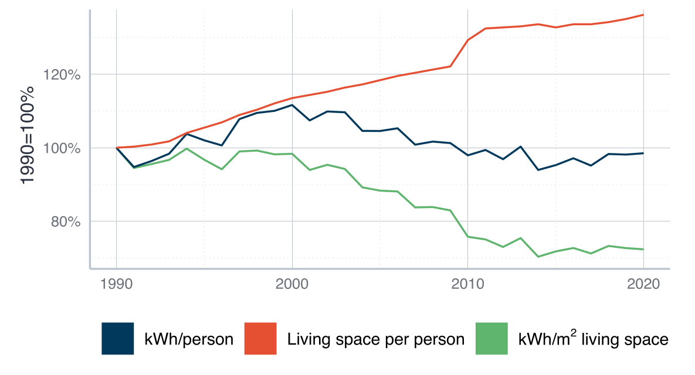
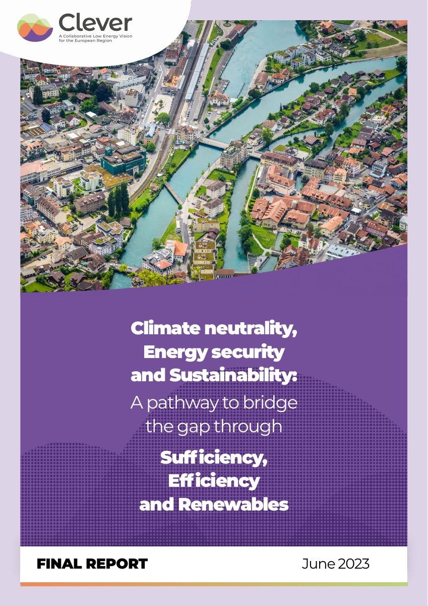

## Learning goals

::: {.upper-roman}
I.  Understand the broad types of environmental policies and how they relate to the so-called **Kaya identity**
II. Get to know the **four classical types** of environmental policy
III. Understand the difference between **market-based** and **non-market-based** policies
IV. Think critically about the **potential and limits** of existing policies, including **rebound effects**
:::

## Three broad categories {.divider background-color="#00395B"}

::: {.secnum}
01
:::

## Three categories of environmental policy

<!-- Explicit fragment indices. The empty .trigger divs start what happens inside the
     formula: MathJax builds it after reveal has collected its fragments, so the struck
     terms cannot be fragments themselves. --fx/--fy: distance from each result symbol
     up to its place in the identity, measured at 1600 x 900. -->

::: {.nonincremental}
- Baseline relationship: the **Kaya identity**
:::

::: {.trigger .go-p .fragment fragment-index=6}
:::

::: {.trigger .go-g .fragment fragment-index=7}
:::

::: {.trigger .go-e .fragment fragment-index=8}
:::

::: {.trigger .go-fly .fragment fragment-index=9}
:::

::: {.kaya}
::: {.term}
$\class{orig}{\mathcal{E}}$

[Total environmental stressors]{.lab .fragment fragment-index=1}
:::

::: {.op}
$=$
:::

::: {.term}
$\require{cancel}\class{cs-p}{\cancel{P}}$

[Population]{.lab .fragment fragment-index=2}
:::

::: {.op}
$\cdot$
:::

::: {.term}
$\dfrac{\class{cs-g}{\cancel{\mathit{GDP}}}}{\class{cs-p}{\cancel{P}}}$

[GDP per person]{.lab .fragment fragment-index=3}
:::

::: {.op}
$\cdot$
:::

::: {.term}
$\dfrac{\class{cs-e}{\cancel{E}}}{\class{cs-g}{\cancel{\mathit{GDP}}}}$

[Energy per unit of GDP]{.lab .fragment fragment-index=4}
:::

::: {.op}
$\cdot$
:::

::: {.term}
$\dfrac{\class{orig}{\mathcal{E}}}{\class{cs-e}{\cancel{E}}}$

[Environmental stressors per energy unit]{.lab .fragment fragment-index=5}
:::
:::

::: {.kaya-result}
[$\mathcal{E}$]{.fly .fragment fragment-index=9 style="--fx: 55px; --fy: -238px;"} [$=$]{.fragment fragment-index=9} [$\mathcal{E}$]{.fly .fragment fragment-index=9 style="--fx: 836px; --fy: -272px;"}

::: {.arrow .fragment fragment-index=10}
True by construction: **decomposition**, no explanation
:::
:::

::: {.source}
Kaya & Yokobori [-@kaya1997], for CO₂; generalised here to any stressor, in the spirit of IPAT [@ehrlich1971]. The last term fits energy-related stressors best.
:::

## Three categories of environmental policy

<!-- Explicit fragment indices: each strategy frames its term in the identity. -->

::: {.kaya .compact}
::: {.term}
$\mathcal{E}$
:::

::: {.op}
$=$
:::

::: {.term .fragment .hl fragment-index=3}
$P$
:::

::: {.op}
$\cdot$
:::

::: {.term .fragment .hl fragment-index=3}
$\dfrac{\mathit{GDP}}{P}$
:::

::: {.op}
$\cdot$
:::

::: {.term .fragment .hl fragment-index=1}
$\dfrac{E}{\mathit{GDP}}$
:::

::: {.op}
$\cdot$
:::

::: {.term .fragment .hl fragment-index=2}
$\dfrac{\mathcal{E}}{E}$
:::
:::

::: {.upper-roman .kaya-list .nonincremental .synced}
::: {.fragment fragment-index=1}
I.  Addressing $\dfrac{E}{\mathit{GDP}}$ → **efficiency** strategies
:::

::: {.fragment fragment-index=2}
II.  Addressing $\dfrac{\mathcal{E}}{E}$ → **renewable-based** (or ‘consistency’) strategies
:::

::: {.fragment fragment-index=3}
III.  Addressing the level of activity, $\mathit{GDP}$ and/or $\dfrac{\mathit{GDP}}{P}$ → **sufficiency** strategies
:::
:::

::: {.keybox .fragment fragment-index=4}
**Caution:** a static view that ignores dynamic interrelations between the terms. E.g., could lower GDP affect the feasibility of consistency strategies?
:::

::: {.arrow .fragment fragment-index=5}
$P$ also inside total GDP: what about population?
:::

::: {.notes}
**Why static?** The identity holds in every year, but it says nothing about how the terms affect each other. Read as four separate levers, it suggests that one term can change while the others stay as they are.

**The example:** in the identity, lower GDP simply means lower emissions. But the energy transition has to be built and financed, so lower GDP could also make $\mathcal{E}/E$ harder to reduce. Warlenius [-@warlenius2023, pp. 7–8] argues along these lines and expects growth to be more likely than degrowth to enable fast transitions.

**This is disputed.** Jackson et al. [-@jackson2024] reply that the identity makes no causal claim and remains a useful check on growth and decoupling scenarios. They also argue that growth raises the required rate of decoupling, and that reducing unnecessary production frees capacity for the transition. → Session 8.

**Rebound** is another such interaction: efficiency gains in $E/\mathit{GDP}$ can raise activity.
:::

::: {.source}
The triad of efficiency, consistency and sufficiency: Huber [-@huber1995]. Static vs. dynamic view: Warlenius [-@warlenius2023]; Jackson et al. [-@jackson2024].
:::

## And what about population?

- $P$ not targeted by any of the three strategies
- Population policy: heavily contested
  - A **coercive history**, often pushed and funded from the Global North
  - India 1975–77: over 10 million sterilisations, many forced · China: one-child policy, 1980–2015
- Fastest population growth where emissions per person are lowest:

::: {.fragment}
| Countries, 2022 | Share of world population | Share of world CO₂ | CO₂ per person | Population growth since 1990 |
|-----------------|---------------------------|--------------------|----------------|------------------------------|
| Low income      | 9%                        | 0.5%               | 0.3 t          | +145%                        |
| High income     | 16%                       | 39%                | 11.6 t         | +22%                         |

: {.econ .popshare}
:::

::: {.arrow .fragment}
$P$ kept in decomposition, but not treated as a policy instrument here
:::

::: {.notes}
**"Pushed and funded from the Global North":** from the 1950s on, a transnational population-control movement led from the West (US government, private foundations, international organisations) treated high fertility in poorer countries as a threat, and financed and pressed for programmes there.

**India is the textbook case.** In the 1960s President Johnson used food aid during crop failures as leverage for family planning, and the World Bank under McNamara pressed India to step up sterilisation. The Emergency sterilisations of 1975–77 were still carried out by the Indian state, with Sanjay Gandhi as the driving figure. Responsibility is shared.

**China is different**, hence "often", not "always". The one-child policy was a domestic decision. The link to the North is at most intellectual: Song Jian's modelling, inspired by *Limits to Growth*. How much it mattered is disputed.

**Why this matters here:** the identity shows $P$ as a multiplier, which can suggest "fewer people in poor countries". The table shows that population grows fastest where emissions per person are lowest.
:::

::: {.source}
Connelly [-@connelly2008]; Satterthwaite [-@satterthwaite2009]. India: official figures tabled in the Lok Sabha, 2025. Table: Our World in Data, production-based CO₂, World Bank income groups.
:::

## Worked example: which term drives emissions?

<!-- Waterfall drawn by hand from analysis/policy_02_figures.R: if the numbers
     change there, change them here. Bars in Mt CO2; each panel has its own scale. -->

```{=html}
<svg class="diagram sd wf" viewBox="0 0 1340 325" width="1340" role="img" aria-label="Kaya decomposition of production-based CO2, 1990 to 2022, in Mt. Germany: 1,055 in 1990, population +45, GDP per person +517, energy per GDP −737, CO2 per energy −209, 671 in 2022. China: 2,485 in 1990, population +1,234, GDP per person +10,878, energy per GDP −2,049, CO2 per energy −1,197, 11,351 in 2022">
  <text class="firm" x="328" y="24" text-anchor="middle">Germany, Mt CO₂: −36%</text>
  <path class="ax" d="M 10 270 L 646 270"/>
  <g class="fragment" data-fragment-index="0"><rect class="bar-b" x="26" y="136.3" width="72" height="133.7"/><text class="val up" x="62.0" y="128.3" text-anchor="middle">1,055</text></g>
  <path class="fragment conn" data-fragment-index="1" d="M 98 136.3 L 132 136.3"/>
  <rect class="fragment rise bar-up" data-fragment-index="1" x="132" y="130.5" width="72" height="5.8"/>
  <text class="val fragment" data-fragment-index="1" x="168.0" y="122.5" text-anchor="middle">+45</text>
  <path class="fragment conn" data-fragment-index="2" d="M 204 130.5 L 238 130.5"/>
  <rect class="fragment rise bar-up" data-fragment-index="2" x="238" y="65.0" width="72" height="65.5"/>
  <text class="val fragment" data-fragment-index="2" x="274.0" y="57.0" text-anchor="middle">+517</text>
  <path class="fragment conn" data-fragment-index="3" d="M 310 65.0 L 344 65.0"/>
  <rect class="fragment rise down bar-down" data-fragment-index="3" x="344" y="65.0" width="72" height="93.4"/>
  <text class="val fragment" data-fragment-index="3" x="380.0" y="180.4" text-anchor="middle">−737</text>
  <path class="fragment conn" data-fragment-index="4" d="M 416 158.4 L 450 158.4"/>
  <rect class="fragment rise down bar-down" data-fragment-index="4" x="450" y="158.4" width="72" height="26.5"/>
  <text class="val fragment" data-fragment-index="4" x="486.0" y="206.9" text-anchor="middle">−209</text>
  <path class="fragment conn" data-fragment-index="5" d="M 522 184.9 L 556 184.9"/>
  <g class="fragment" data-fragment-index="5"><rect class="bar-b" x="556" y="184.9" width="72" height="85.1"/><text class="val up" x="592.0" y="176.9" text-anchor="middle">671</text></g>
  <text class="lg sm" x="62.0" y="294" text-anchor="middle">1990</text>
  <text class="lg sm" x="168.0" y="294" text-anchor="middle">Population</text>
  <text class="lg sm" x="274.0" y="294" text-anchor="middle">GDP</text>
  <text class="lg sm" x="274.0" y="316" text-anchor="middle">per person</text>
  <text class="lg sm" x="380.0" y="294" text-anchor="middle">Energy</text>
  <text class="lg sm" x="380.0" y="316" text-anchor="middle">per GDP</text>
  <text class="lg sm" x="486.0" y="294" text-anchor="middle">CO₂</text>
  <text class="lg sm" x="486.0" y="316" text-anchor="middle">per energy</text>
  <text class="lg sm" x="592.0" y="294" text-anchor="middle">2022</text>
  <text class="firm" x="1012" y="24" text-anchor="middle">China, Mt CO₂: +357%</text>
  <path class="ax" d="M 694 270 L 1330 270"/>
  <g class="fragment" data-fragment-index="0"><rect class="bar-b" x="710" y="235.1" width="72" height="34.9"/><text class="val up" x="746.0" y="227.1" text-anchor="middle">2,485</text></g>
  <path class="fragment conn" data-fragment-index="1" d="M 782 235.1 L 816 235.1"/>
  <rect class="fragment rise bar-up" data-fragment-index="1" x="816" y="217.8" width="72" height="17.3"/>
  <text class="val fragment" data-fragment-index="1" x="852.0" y="209.8" text-anchor="middle">+1,234</text>
  <path class="fragment conn" data-fragment-index="2" d="M 888 217.8 L 922 217.8"/>
  <rect class="fragment rise bar-up" data-fragment-index="2" x="922" y="65.0" width="72" height="152.8"/>
  <text class="val fragment" data-fragment-index="2" x="958.0" y="57.0" text-anchor="middle">+10,878</text>
  <path class="fragment conn" data-fragment-index="3" d="M 994 65.0 L 1028 65.0"/>
  <rect class="fragment rise down bar-down" data-fragment-index="3" x="1028" y="65.0" width="72" height="28.8"/>
  <text class="val fragment" data-fragment-index="3" x="1064.0" y="115.8" text-anchor="middle">−2,049</text>
  <path class="fragment conn" data-fragment-index="4" d="M 1100 93.8 L 1134 93.8"/>
  <rect class="fragment rise down bar-down" data-fragment-index="4" x="1134" y="93.8" width="72" height="16.8"/>
  <text class="val fragment" data-fragment-index="4" x="1170.0" y="132.6" text-anchor="middle">−1,197</text>
  <path class="fragment conn" data-fragment-index="5" d="M 1206 110.6 L 1240 110.6"/>
  <g class="fragment" data-fragment-index="5"><rect class="bar-b" x="1240" y="110.6" width="72" height="159.4"/><text class="val up" x="1276.0" y="102.6" text-anchor="middle">11,351</text></g>
  <text class="lg sm" x="746.0" y="294" text-anchor="middle">1990</text>
  <text class="lg sm" x="852.0" y="294" text-anchor="middle">Population</text>
  <text class="lg sm" x="958.0" y="294" text-anchor="middle">GDP</text>
  <text class="lg sm" x="958.0" y="316" text-anchor="middle">per person</text>
  <text class="lg sm" x="1064.0" y="294" text-anchor="middle">Energy</text>
  <text class="lg sm" x="1064.0" y="316" text-anchor="middle">per GDP</text>
  <text class="lg sm" x="1170.0" y="294" text-anchor="middle">CO₂</text>
  <text class="lg sm" x="1170.0" y="316" text-anchor="middle">per energy</text>
  <text class="lg sm" x="1276.0" y="294" text-anchor="middle">2022</text>
</svg>
```

::: {.wf-notes}
- **Germany**: efficiency and cleaner energy beat growth · **China**: growth dwarfs both
- Per person, 2022: **8.0 t** in both (1990: Germany 13.2 t, China 2.2 t) · consumption-based: Germany 9.9 t, China 7.2 t
- Consumption-based: Germany −30% instead of −36% → **offshoring explains little**, Session 6
:::

::: {.notes}
**How much of Germany's decline is offshoring?** Net CO₂ imports rose from 140 to 161 Mt, 1990–2022: about 21 Mt of the 383 Mt decline, roughly 5%. Production-based 1,055 → 671 Mt (−36%), consumption-based 1,195 → 833 Mt (−30%).

**This depends on the period:** to 2010 it is about 23% (+52 of −228 Mt). Net imports move between 94 Mt (2015) and 192 Mt (2010). They also reflect partners' carbon intensity and trade composition, not only relocated production. And 1990 includes the collapse of East German industry.

**China** is the mirror image: net exports of 1,041 Mt in 2022, so 9% of its emissions serve consumption elsewhere.

**Territorial vs. production-based:** used as synonyms here. Strictly, territorial means emitted inside the borders, as in UNFCCC inventories, with international aviation and shipping reported separately. Production-based accounts can also follow residents, as in environmental-economic accounts, and then include bunker fuels.

**The LMDI formula:** effect of a term = $L \cdot \ln(\text{term}_{2022} / \text{term}_{1990})$, with $L$ the logarithmic mean of emissions in the two years. The effects sum exactly to the total change. The session page has the computations for Germany.
:::

::: {.source}
Our World in Data: production-based (territorial) and consumption-based CO₂, primary energy, GDP (PPP, Maddison), population. Additive LMDI decomposition [@ang2005], in Mt CO₂; each panel has its own scale. Code: `analysis/policy_02_figures.R`.
:::

## Short task

- Gather in groups of 2 to 3 people, take about 5 minutes for this task
- Think of examples for policies that belong to each of the three categories:

::: {.grid3 .fragment style="margin: 0.5em 0 0.7em 0;"}
::: {.cap}
[Efficiency]{.caphead}

Address $\dfrac{E}{\mathit{GDP}}$ (energy per unit of GDP)
:::

::: {.cap}
[Consistency]{.caphead}

Address $\dfrac{\mathcal{E}}{E}$ (stressors per unit of energy)
:::

::: {.cap}
[Sufficiency]{.caphead}

Address $\mathit{GDP}$ or $\dfrac{\mathit{GDP}}{P}$ (GDP in total or per person)
:::
:::

::: {.columns style="align-items: center;"}
::: {.column width="78%"}
- Which kind of policies appear most prominent in your country?
:::

::: {.column .qrcol .timer-xs width="22%"}
::: {#short-task-timer .timer seconds="300" starton="interaction"}
:::
:::
:::

## Three broad categories

- Biggest 'tension': **efficiency/consistency vs. sufficiency**
  - Key question: sustain/enlarge consumption and production activities while reducing environmental costs? 
- Two 'camps', two answers to the twin challenge:
  - Different growth strategies → green growth within capitalism (~ Modernisation)
  - Radical system change: sufficiency, degrowth, de-globalisation, equality, more public services (~ Post-Development)
- Focus today: practically relevant policy measures and their underlying **theoretical rationale**

## Classical environmental policy {.divider background-color="#00395B"}

::: {.secnum}
02
:::

## Classical environmental policy: four main instruments

<!-- The .trigger divs colour the boxes when their label appears at the bottom. -->

::: {.trigger .go-nm .fragment fragment-index=5}
:::

::: {.trigger .go-mb .fragment fragment-index=6}
:::

::: {.grid2 style="margin-top: 0.8em;"}
::: {.cap .nm .fragment fragment-index=1}
[Pollution standards]{.caphead}

Legal limits for emissions of individual sources
:::

::: {.cap .nm .fragment fragment-index=2}
[Technology standards]{.caphead}

Prescription of specific production or control technologies
:::

::: {.cap .mb .fragment fragment-index=3}
[Pollution taxes]{.caphead}

A fee levied on each unit of pollutant emitted
:::

::: {.cap .mb .fragment fragment-index=4}
[Pollution allowances]{.caphead}

Distribute tradable allowances for emitting pollutants
:::
:::

::: {.instr-legend}
[Non-market-based]{.chip .nm .fragment fragment-index=5} [Market-based]{.chip .mb .fragment fragment-index=6}
:::

## Digression: prices on a competitive market

<!-- Explicit fragment indices throughout: the diagram and its bullets move together.
     The price line is nested in two moving groups: too high, then too low, then right. -->

```{=html}
<svg class="diagram sd mid" viewBox="0 0 720 505" width="860" role="img" aria-label="Supply and demand diagram for automobiles: at a price above equilibrium there is excess supply and the price falls, at a price below it there is excess demand and the price rises, until the market reaches its equilibrium">
  <path class="ax" d="M 70 20 L 70 440 L 650 440"/>
  <text class="lg" text-anchor="middle" transform="translate(24,230) rotate(-90)"><tspan class="it">P</tspan> (e.g., price of automobiles)</text>
  <text class="lg" x="360" y="496" text-anchor="middle"><tspan class="it">Q</tspan> (e.g., number of automobiles)</text>
  <g class="fragment draw" data-fragment-index="1">
    <path class="stroke cv" pathLength="1" d="M 70 110 L 560 370"/>
    <text class="lg" x="585" y="398" text-anchor="middle">Demand curve</text>
    <text class="lg" x="585" y="421" text-anchor="middle">(private marginal benefits)</text>
  </g>
  <g class="fragment draw" data-fragment-index="2">
    <path class="stroke cv" pathLength="1" d="M 70 340 L 560 109"/>
    <text class="lg" x="600" y="165" text-anchor="middle">Supply curve</text>
    <text class="lg" x="600" y="188" text-anchor="middle">(private marginal costs)</text>
  </g>
  <g class="fragment" data-fragment-index="3">
    <g class="fragment mv" data-fragment-index="4" style="--ty: 150px;">
      <g class="fragment mv" data-fragment-index="5" style="--ty: -68px;">
        <path class="price" d="M 70 150 L 560 150"/>
        <text class="val" x="60" y="156" text-anchor="end">P</text>
      </g>
    </g>
  </g>
  <g class="fragment fade-in-then-out" data-fragment-index="3">
    <path class="gap" d="M 145 150 L 473 150"/>
    <circle class="pt" cx="145" cy="150" r="7"/>
    <circle class="pt" cx="473" cy="150" r="7"/>
    <text class="l-red" x="309" y="134" text-anchor="middle">Excess supply: price falls ↓</text>
  </g>
  <g class="fragment fade-in-then-out" data-fragment-index="4">
    <path class="gap" d="M 155 300 L 428 300"/>
    <circle class="pt" cx="155" cy="300" r="7"/>
    <circle class="pt" cx="428" cy="300" r="7"/>
    <text class="l-red" x="291" y="328" text-anchor="middle">Excess demand: price rises ↑</text>
  </g>
  <g class="fragment" data-fragment-index="5">
    <path class="dot" d="M 300 232 L 300 440"/>
    <circle class="pt" cx="300" cy="232" r="7"/>
    <text class="lbl" x="400" y="222">Market equilibrium</text>
    <text class="val" x="300" y="466" text-anchor="middle">Q<tspan class="sup" dy="-8">M</tspan></text>
  </g>
</svg>
```

## Without external effects, free markets maximise welfare

<!-- The two "wrong quantity" triangles are shown one click each, then disappear. -->

```{=html}
<svg class="diagram sd mid" viewBox="0 0 720 505" width="860" role="img" aria-label="Supply and demand diagram: consumer welfare above the market price, producer welfare below it; a quantity below or above the market quantity loses welfare">
  <path class="ax" d="M 70 20 L 70 440 L 650 440"/>
  <text class="lg" text-anchor="middle" transform="translate(24,230) rotate(-90)"><tspan class="it">P</tspan> (e.g., price of automobiles)</text>
  <text class="lg" x="360" y="496" text-anchor="middle"><tspan class="it">Q</tspan> (e.g., number of automobiles)</text>
  <path class="cv" d="M 70 110 L 560 370"/>
  <text class="lg" x="585" y="398" text-anchor="middle">Demand curve</text>
  <text class="lg" x="585" y="421" text-anchor="middle">(private marginal benefits)</text>
  <path class="cv" d="M 70 340 L 560 109"/>
  <text class="lg" x="600" y="165" text-anchor="middle">Supply curve</text>
  <text class="lg" x="600" y="188" text-anchor="middle">(private marginal costs)</text>
  <g class="fragment" data-fragment-index="1">
    <polygon class="cs" points="70,110 70,232 300,232"/>
    <text class="l-cs" x="170" y="84" text-anchor="middle">Consumer welfare</text>
    <text class="l-cs" x="170" y="107" text-anchor="middle">(benefit − price)</text>
  </g>
  <g class="fragment" data-fragment-index="2">
    <polygon class="ps" points="70,232 70,340 300,232"/>
    <text class="l-ps" x="226" y="352" text-anchor="end">Producer</text>
    <text class="l-ps" x="226" y="375" text-anchor="end">welfare</text>
    <text class="l-ps" x="226" y="398" text-anchor="end">(price − costs)</text>
  </g>
  <path class="dot" d="M 70 232 L 300 232 M 300 232 L 300 440"/>
  <circle class="pt" cx="300" cy="232" r="7"/>
  <text class="val" x="60" y="238" text-anchor="end">P<tspan class="sup" dy="-8">M</tspan></text>
  <text class="val" x="300" y="466" text-anchor="middle">Q<tspan class="sup" dy="-8">M</tspan></text>
  <g class="fragment fade-in-then-out" data-fragment-index="3">
    <polygon class="lost" points="235,197.5 300,232 235,262.4"/>
    <path class="dot" d="M 235 197.5 L 235 440"/>
    <text class="val" x="235" y="466" text-anchor="middle">Q′</text>
    <path class="leader" d="M 272 60 L 272 226"/>
    <text class="l-red" x="272" y="50">Too little: welfare lost</text>
  </g>
  <g class="fragment fade-in-then-out" data-fragment-index="4">
    <polygon class="lost" points="300,232 375,196 375,272"/>
    <path class="dot" d="M 375 196 L 375 440"/>
    <text class="val" x="375" y="466" text-anchor="middle">Q″</text>
    <text class="l-red" x="392" y="240">Too much:</text>
    <text class="l-red" x="392" y="263">costs &gt; benefits</text>
  </g>
</svg>
```

::: {.arrow .tight .fragment}
Welfare maximised: $Q^M = Q^*$ and $P^M = P^*$
:::

::: {.arrow .tight .fragment}
Not true if **external effects** are present
:::

## With external effects, free markets are inefficient

```{=html}
<svg class="diagram sd mid" viewBox="0 0 720 505" width="860" role="img" aria-label="Supply and demand diagram: the external cost of one more car lifts the private supply curve to the social marginal cost curve; the social optimum has a higher price and a lower quantity than the market equilibrium; the units in between cost society more than they are worth">
  <path class="ax" d="M 70 20 L 70 440 L 650 440"/>
  <text class="lg" text-anchor="middle" transform="translate(24,230) rotate(-90)"><tspan class="it">P</tspan> (e.g., price of automobiles)</text>
  <text class="lg" x="360" y="496" text-anchor="middle"><tspan class="it">Q</tspan> (e.g., number of automobiles)</text>
  <path class="cv" d="M 70 110 L 560 370"/>
  <text class="lg" x="585" y="398" text-anchor="middle">Demand curve</text>
  <text class="lg" x="585" y="421" text-anchor="middle">(private marginal benefits)</text>
  <path class="cv" d="M 70 340 L 560 109"/>
  <text class="lg" x="600" y="165" text-anchor="middle">Supply curve</text>
  <text class="lg" x="600" y="188" text-anchor="middle">(private marginal costs)</text>
  <path class="dot" d="M 70 232 L 300 232 M 300 232 L 300 440"/>
  <circle class="pt" cx="300" cy="232" r="7"/>
  <text class="val" x="60" y="238" text-anchor="end">P<tspan class="sup" dy="-8">M</tspan></text>
  <text class="val" x="300" y="466" text-anchor="middle">Q<tspan class="sup" dy="-8">M</tspan></text>
  <g class="fragment draw" data-fragment-index="1">
    <path class="stroke arrow-red" pathLength="1" d="M 430 170 L 430 104"/>
    <polygon class="head fill-red" points="0,0 -14,-7 -14,7" transform="translate(430,95) rotate(-90)"/>
    <text class="l-red" x="420" y="72" text-anchor="end">External cost of one more car</text>
  </g>
  <g class="fragment" data-fragment-index="2">
    <g class="fragment mv" data-fragment-index="2" style="--ty: -75px;">
      <path class="cv smc" d="M 70 340 L 560 109"/>
    </g>
    <text class="l-teal" x="550" y="20" text-anchor="end">Social marginal costs</text>
    <path class="brace" d="M 568 36 L 576 36 L 576 107 L 568 107"/>
    <text class="l-red" x="586" y="78">External costs</text>
  </g>
  <g class="fragment" data-fragment-index="3">
    <path class="dot" d="M 70 192 L 225 192 M 225 192 L 225 440"/>
    <circle class="pt smcpt" cx="225" cy="192" r="7"/>
    <text class="l-teal" x="225" y="130" text-anchor="middle">Social</text>
    <text class="l-teal" x="225" y="153" text-anchor="middle">optimum</text>
    <text class="val" x="60" y="198" text-anchor="end">P<tspan class="sup" dy="-8">*</tspan></text>
    <text class="val" x="225" y="466" text-anchor="middle">Q<tspan class="sup" dy="-8">*</tspan></text>
  </g>
  <g class="fragment" data-fragment-index="4">
    <polygon class="lost" points="225,192 300,157 300,232"/>
    <text class="l-red" x="308" y="178">Welfare</text>
    <text class="l-red" x="308" y="200">loss</text>
  </g>
</svg>
```

::: {.arrow .tight .fragment}
Market equilibrium: **inefficient**
:::

::: {.arrow .tight .fragment}
Neoclassical idea: **shift** it to the social optimum by changing market institutions
:::

## Pollution standards: "command & control"

- **Threshold** for pollution, binding for all firms
  - A **non-market-based** approach
  - Example: EU limit for new cars, carbon monoxide: 1.0 g/km (petrol), 0.5 g/km (diesel)
- **Advantage:** transparent, clear limit for all units
- **Disadvantage:** inflexible, especially with heterogeneous units
  - Same treatment, irrespective of marginal costs for emission reduction
  - No incentive to go further below the threshold

## Technology standards

- **Prescribed technology** for all firms
  - A **non-market-based** approach
  - Example: catalytic converter required in all cars
- Dynamic version: **BACT**, the best available control technology
- **Advantages:**
  - Potentially lower costs for control technologies
  - Easy to monitor, can be tailored to local needs
- **Disadvantages:**
  - Little incentive to innovate, neglect of firm heterogeneity

## Pollution taxes: a market-based approach

<!-- Explicit fragment indices (reveal puts unindexed fragments last). The taxed
     supply curve and the equilibrium point are nested in two moving groups:
     from the supply curve to tax rate T1, then on to the full external costs. -->

::: {.columns style="gap: 1.2em; align-items: center;"}
::: {.column width="56%"}
```{=html}
<svg class="diagram sd" viewBox="0 0 720 490" width="760" role="img" aria-label="Supply and demand diagram with a tax: the tax lifts the supply curve; a tax rate T1 already lowers the quantity; a tax equal to the external costs reaches the social optimum and raises tax revenue">
  <path class="ax" d="M 70 20 L 70 440 L 650 440"/>
  <text class="lg it" x="70" y="12" text-anchor="middle">P</text>
  <text class="lg it" x="664" y="447" text-anchor="middle">Q</text>
  <path class="cv" d="M 70 110 L 560 370"/>
  <text class="lg" x="585" y="398" text-anchor="middle">Demand curve</text>
  <text class="lg" x="585" y="421" text-anchor="middle">(private marginal benefits)</text>
  <path class="cv" d="M 70 340 L 560 109"/>
  <text class="lg" x="600" y="165" text-anchor="middle">Supply curve</text>
  <text class="lg" x="600" y="188" text-anchor="middle">(private marginal costs)</text>
  <path class="cv smc" d="M 70 265 L 560 34"/>
  <text class="l-teal" x="550" y="20" text-anchor="end">Social marginal costs</text>
  <path class="brace" d="M 568 36 L 576 36 L 576 107 L 568 107"/>
  <text class="l-red" x="586" y="78">External costs</text>
  <path class="dot" d="M 70 232 L 300 232 M 300 232 L 300 440"/>
  <text class="val" x="60" y="243" text-anchor="end">P<tspan class="sup" dy="-8">M</tspan></text>
  <text class="val" x="306" y="466" text-anchor="middle">Q<tspan class="sup" dy="-8">M</tspan></text>
  <g class="fragment" data-fragment-index="3">
    <path class="dot-t1" d="M 70 213 L 264 213 M 264 213 L 264 440"/>
    <text class="val" x="60" y="219" text-anchor="end">P<tspan class="sup" dy="-8">T₁</tspan></text>
    <text class="val" x="264" y="466" text-anchor="middle">Q<tspan class="sup" dy="-8">T₁</tspan></text>
  </g>
  <g class="fragment" data-fragment-index="4">
    <path class="dot" d="M 70 192 L 225 192 M 225 192 L 225 440"/>
    <text class="l-teal" x="225" y="130" text-anchor="middle">Social</text>
    <text class="l-teal" x="225" y="153" text-anchor="middle">optimum</text>
    <text class="val" x="60" y="195" text-anchor="end">P<tspan class="sup" dy="-8">*</tspan></text>
    <text class="val" x="222" y="466" text-anchor="middle">Q<tspan class="sup" dy="-8">*</tspan></text>
  </g>
  <g class="fragment" data-fragment-index="5">
    <rect class="rev" x="70" y="192" width="155" height="75"/>
    <path class="leader-blue" d="M 147 332 L 147 250"/>
    <text class="l-blue" x="147" y="352" text-anchor="middle">Tax revenue</text>
  </g>
  <g class="fragment" data-fragment-index="3">
    <g class="fragment mv" data-fragment-index="3" style="--ty: -35px;">
      <g class="fragment mv" data-fragment-index="4" style="--ty: -40px;">
        <path class="cv t1" d="M 70 340 L 560 109"/>
      </g>
    </g>
  </g>
  <g class="fragment mv" data-fragment-index="3" style="--tx: -36px; --ty: -19px;">
    <g class="fragment mv" data-fragment-index="4" style="--tx: -39px; --ty: -21px;">
      <circle class="pt mvpt" cx="300" cy="232" r="8"/>
    </g>
  </g>
</svg>
```
:::

::: {.column width="44%"}
::: {.nonincremental .synced}
::: {.fragment fragment-index=1}
- Polluters not forced, but **incentivised** to reduce emissions
:::

::: {.fragment fragment-index=2}
- Taxes *T* paid on top of the price *P*
:::

::: {.fragment fragment-index=3}
- Tax rate *T*~1~: already less pollution
:::

::: {.fragment fragment-index=4}
- *T* = the external costs → social optimum: a **Pigouvian tax**
:::

::: {.fragment fragment-index=5}
- **Revenue** for the state
:::
:::
:::
:::

## Pollution taxes: pros and cons

- **Double dividend**: less pollution *and* government revenue
  - Revenue → reduce distortive taxes or achieve distributional goals
- Other **advantages**:
  - Continuous incentive to reduce emissions further
  - Accounts for heterogeneous marginal costs of emission reduction
- **Disadvantages**:
  - Often difficult to implement and sustain politically
  - Right extent of taxation & follow-up redistribution hard to identify
  - Distortions through political influence of powerful parties

## Pollution allowances

- **Maximum of total emissions** set by policy makers
  - **Cap:** fixes quantity, lets the price move
  - **Tax:** fixes (markup) price, quantity emerges
- Allowances issued by the state, adding up to that maximum
  - Distribution to potential polluters
  - Pollution only to the extent of allowances owned
- Initial allocation:
  - Free distribution vs. auction
  - Revenue effect and double dividend only with an auction
- If allowances are **tradable** → market-based solution
  - Higher costs of emission reduction → buy allowances

## Why trade? Same cap, lower costs

<!-- One allowance block slides from firm A to firm B; beneath it the extra
     abatement of firm A becomes visible. -->

::: {.columns style="gap: 1.6em; align-items: flex-start;"}
::: {.column width="48%"}
```{=html}
<svg class="diagram sd trade" viewBox="0 0 700 500" width="660" role="img" aria-label="Two firms, each emitting 30 tonnes with 20 allowances. Without trade each abates 10 tonnes. With trade, firm A, the cheap abater, abates 20 tonnes and sells 10 allowances to firm B, which abates nothing. Total emissions stay at 40 tonnes">
  <text class="firm" x="165" y="42" text-anchor="middle">Firm A</text>
  <text class="lg" x="165" y="68" text-anchor="middle">abating costs €10 per tonne</text>
  <text class="firm" x="505" y="42" text-anchor="middle">Firm B</text>
  <text class="lg" x="505" y="68" text-anchor="middle">abating costs €50 per tonne</text>
  <rect class="abate" x="100" y="100" width="130" height="200"/>
  <rect class="allow" x="100" y="300" width="130" height="100"/>
  <text class="on-dark" x="165" y="356" text-anchor="middle">10 t emitted</text>
  <text class="on-light" x="165" y="156" text-anchor="middle">abate 10 t</text>
  <text class="on-light" x="165" y="256" text-anchor="middle">+ 10 t abated</text>
  <rect class="abate" x="440" y="100" width="130" height="100"/>
  <rect class="allow" x="440" y="200" width="130" height="200"/>
  <text class="on-dark" x="505" y="306" text-anchor="middle">20 t emitted</text>
  <text class="on-light" x="505" y="156" text-anchor="middle">abate 10 t</text>
  <g class="fragment mv" data-fragment-index="2" style="--tx: 340px; --ty: -100px;">
    <rect class="allow moving" x="100" y="200" width="130" height="100"/>
    <text class="on-dark" x="165" y="244" text-anchor="middle">10 allow-</text>
    <text class="on-dark" x="165" y="270" text-anchor="middle">ances</text>
  </g>
  <g class="fragment draw" data-fragment-index="3">
    <path class="stroke money" pathLength="1" d="M 505 428 C 505 462, 165 462, 165 420"/>
    <polygon class="head fill-teal" points="0,0 -14,-7 -14,7" transform="translate(165,408) rotate(-90)"/>
    <text class="l-teal" x="335" y="490" text-anchor="middle">€300 for 10 allowances (€30 each)</text>
  </g>
</svg>
```
:::

::: {.column width="52%"}
<table class="econ trade-table">
<thead><tr><th></th><th>Firm A</th><th>Firm B</th><th>Total</th></tr></thead>
<tbody>
<tr class="fragment" data-fragment-index="1"><td>Abatement cost, no trade</td><td>€100</td><td>€500</td><td>€600</td></tr>
<tr class="fragment" data-fragment-index="2"><td>Abatement cost, with trade</td><td>€200</td><td>€0</td><td><strong>€200</strong></td></tr>
<tr class="fragment" data-fragment-index="3"><td>Allowance payments</td><td>−€300</td><td>+€300</td><td>€0</td></tr>
<tr class="fragment" data-fragment-index="3"><td>Net cost</td><td>−€100</td><td>€300</td><td>€200</td></tr>
</tbody>
</table>

::: {.nonincremental .synced style="margin-top: 0.7em;"}
::: {.fragment fragment-index=0}
- Each firm: 30 t emissions, 20 allowances → cap of **40 t**
:::

::: {.fragment fragment-index=4}
- Emissions stay at 40 t, both firms gain
:::

::: {.fragment fragment-index=5}
- Abatement where it is **cheapest**: heterogeneity as an asset
:::
:::
:::
:::

::: {.source}
Illustrative numbers, constant abatement costs per tonne.
:::

## Price or quantity? When costs surprise us

<!-- The cost curve slides up in both panels; the dot shows what gives way. -->

```{=html}
<svg class="diagram sd pq" viewBox="0 0 900 415" width="1080" role="img" aria-label="Two panels with a marginal abatement cost curve. Left: a tax fixes the price; when abatement turns out costlier, the curve moves up and abatement falls. Right: a cap fixes abatement; when the curve moves up, the allowance price rises">
  <text class="firm" x="205" y="20" text-anchor="middle">Tax: fixes the price</text>
  <path class="ax" d="M 40 40 L 40 370 L 380 370"/>
  <text class="lg" x="210" y="404" text-anchor="middle">Abatement</text>
  <text class="lg" text-anchor="middle" transform="translate(20,205) rotate(-90)">€ per tonne</text>
  <path class="tax-line" d="M 40 220 L 370 220"/>
  <path class="old" d="M 40 360 L 320 99"/>
  <g class="fragment mv" data-fragment-index="2" style="--ty: -70px;">
    <path class="cv" d="M 40 360 L 320 99"/>
    <text class="lg" x="332" y="110">Marginal</text>
    <text class="lg" x="332" y="134">abatement</text>
    <text class="lg" x="332" y="158">cost</text>
  </g>

  <g class="fragment mv" data-fragment-index="2" style="--tx: -75px;">
    <path class="dot" d="M 190 220 L 190 370"/>
    <circle class="pt" cx="190" cy="220" r="8"/>
  </g>
  <text class="l-red fragment" data-fragment-index="2" x="130" y="350">← Abatement falls</text>
  <text class="firm" x="675" y="20" text-anchor="middle">Cap: fixes the quantity</text>
  <path class="ax" d="M 510 40 L 510 370 L 850 370"/>
  <text class="lg" x="680" y="404" text-anchor="middle">Abatement</text>
  <text class="lg" text-anchor="middle" transform="translate(490,205) rotate(-90)">€ per tonne</text>
  <path class="tax-line" d="M 660 40 L 660 370"/>
  <path class="old" d="M 510 360 L 790 99"/>
  <g class="fragment mv" data-fragment-index="2" style="--ty: -70px;">
    <path class="cv" d="M 510 360 L 790 99"/>
  </g>
  <g class="fragment mv" data-fragment-index="2" style="--ty: -70px;">
    <path class="dot" d="M 510 220 L 660 220"/>
    <circle class="pt" cx="660" cy="220" r="8"/>
  </g>
  <text class="l-red fragment" data-fragment-index="2" x="680" y="170">Price rises ↑</text>
</svg>
```

::: {.pq-notes .nonincremental .synced}
::: {.fragment fragment-index=1}
- All costs known → same point
:::

::: {.fragment fragment-index=2}
- Cutting emissions costlier than expected: tax holds the price → firms cut **less**; cap holds the quantity → **allowances get more expensive**
:::

::: {.fragment fragment-index=3}
- Which mistake is worse? Steeper damage (tipping points!) → stronger case for **quantity**
:::
:::

::: {.source}
Weitzman [-@weitzman1974].
:::

## How well do these instruments relocate?

<table class="econ travel">
<thead><tr><th>Instrument</th><th>Presupposes</th><th>If that is missing</th></tr></thead>
<tbody>
<tr class="fragment"><td>Pollution standards</td><td>Inspectors, courts, independent enforcement</td><td>Limits on paper, not in the factory</td></tr>
<tr class="fragment"><td>Technology standards</td><td>Technology available, affordable and checkable</td><td>Easiest to verify, but imports and costs bind</td></tr>
<tr class="fragment"><td>Pollution taxes</td><td>Measured emissions, tax administration, formal firms</td><td>Informal sector stays outside</td></tr>
<tr class="fragment"><td>Pollution allowances</td><td>Emission inventories, registries, a liquid market</td><td>Thin markets, weak prices</td></tr>
</tbody>
</table>

- Alternatives: public disclosure, voluntary regulation, community pressure → evidence thin, most encouraging for disclosure
- Link to dependency and structuralist theories (Session 1) · **your country: which preconditions hold?**

::: {.notes}
**Public disclosure** (also "informational regulation"): the regulator collects data on plants' environmental performance and publishes it, for example as ratings. No fines attached. The pressure comes from communities, investors and buyers, and from managers learning about their own emissions and options to cut them. Attractive where inspectors and courts are weak, but someone still has to measure.

**Standard example: PROPER, Indonesia, since 1995.** Plants get a public colour rating, from gold (best) to black (worst), with no sanctions beyond the publicity. Blackman, Afsah & Ratunanda: works largely through better information for plant managers, alongside outside pressure. García, Sterner & Afsah: emissions of organic water pollutants (BOD, COD) down by about 32%, especially among plants with poor records. The response weakens once the first steps are taken.

**Evidence:** thin overall, partly because non-regulatory pressure is hard to isolate. Disclosure is the most encouraging of the alternatives: the heaviest polluters cut emissions. Voluntary regulation is more mixed [@blackman2010].
:::

::: {.source}
Blackman, Li & Liu [-@blackman2018]; Blackman [-@blackman2010]; Sterner & Coria [-@coria2013]. Table: own summary.
:::


## Group activity

::: {.columns style="align-items: center;"}
::: {.column width="80%"}
- Get together in groups of 3–5 people, take about 10 minutes
- Fill out the following table together:
:::

::: {.column .qrcol .timer-xs width="20%"}
::: {#group-activity-timer .timer seconds="600" starton="interaction"}
:::
:::
:::

<table class="econ instr">
<thead><tr><th></th><th>Pollution standards</th><th>Technology standards</th><th>Pollution taxes</th><th>Pollution allowances</th></tr></thead>
<tbody>
<tr><th>Market-based?</th><td></td><td></td><td></td><td></td></tr>
<tr><th>Gives incentive to innovate?</th><td></td><td></td><td></td><td></td></tr>
<tr><th>Required monitoring?</th><td></td><td></td><td></td><td></td></tr>
<tr><th>Double dividend?</th><td></td><td></td><td></td><td></td></tr>
<tr><th>Can it address local hotspots?</th><td></td><td></td><td></td><td></td></tr>
</tbody>
</table>

## Group activity: the table filled in

<table class="econ instr filled">
<thead><tr><th></th><th>Pollution standards</th><th>Technology standards</th><th>Pollution taxes</th><th>Pollution allowances</th></tr></thead>
<tbody>
<tr class="fragment"><th>Market-based?</th><td>No</td><td>No</td><td>Yes</td><td>Yes, if tradable</td></tr>
<tr class="fragment"><th>Gives incentive to innovate?</th><td>Only up to the standard</td><td>Minimal</td><td>Yes</td><td>Yes</td></tr>
<tr class="fragment"><th>Required monitoring?</th><td>Comparatively easy</td><td>Minimal</td><td>Medium to hard</td><td>Medium to hard</td></tr>
<tr class="fragment"><th>Double dividend?</th><td>No</td><td>No</td><td>Yes</td><td>If distributed via auction</td></tr>
<tr class="fragment"><th>Can it address local hotspots?</th><td>Yes, if standards are localised</td><td>Yes</td><td>Not by default</td><td>Not by default</td></tr>
</tbody>
</table>

## Market-based approaches: knowledge and distribution

- **Unknown damage function**
  - $T$ = external costs: requires exact knowledge of these costs
  - Deep uncertainty and 'tipping points' → the case for **quantity** over price
- Analysis mostly based on **static models**: no technological change
  - But: also justifiable from other paradigmatic vantage points
  - Evolutionary theory: often in favour of market-based solutions, but differently
- **Distributional blindness**: tax "efficient" regardless of who bears it
  - Regressive or progressive depending on context: more often progressive in lower-income countries
  - Discrimination and power hierarchies in the blind spot → **environmental justice**, Session 9

::: {.source}
Weitzman [-@weitzman2009]; Ohlendorf et al. [-@ohlendorf2021].
:::


## Alternative views on environmental policy {.divider background-color="#00395B"}

::: {.secnum}
03
:::

## Efficiency gains, but no savings: the rebound effect

<!-- Values read off the figure on the right (rounded), 2020 with 1990 = 100. -->

::: {.columns style="gap: 1.4em; align-items: flex-start;"}
::: {.column width="52%"}
```{=html}
<svg class="diagram sd reb" viewBox="0 0 720 470" width="720" role="img" aria-label="Heating in German housing, 2020 with 1990 at 100: energy per square metre fell to about 72, which would suggest energy per person at 72; but living space per person rose to about 135, so energy per person only fell to about 98">
  <path class="ax" d="M 30 380 L 700 380"/>
  <path class="ref" d="M 30 180 L 700 180"/>
  <text class="lg" x="30" y="170">1990 = 100</text>
  <rect class="fragment rise bar-g" data-fragment-index="1" x="70" y="236" width="130" height="144"/>
  <text class="val fragment" data-fragment-index="1" x="135" y="226" text-anchor="middle">≈ 72</text>
  <text class="lg" x="135" y="408" text-anchor="middle">kWh per m²</text>
  <text class="lg" x="135" y="432" text-anchor="middle">of living space</text>
  <rect class="fragment rise bar-r" data-fragment-index="3" x="290" y="110" width="130" height="270"/>
  <text class="val fragment" data-fragment-index="3" x="355" y="100" text-anchor="middle">≈ 135</text>
  <text class="lg" x="355" y="408" text-anchor="middle">Living space</text>
  <text class="lg" x="355" y="432" text-anchor="middle">per person</text>
  <rect class="fragment ghost" data-fragment-index="2" x="510" y="236" width="130" height="144"/>
  <text class="lg fragment fade-in-then-out" data-fragment-index="2" x="575" y="226" text-anchor="middle">expected: ≈ 72</text>
  <rect class="fragment rise bar-b" data-fragment-index="4" x="510" y="184" width="130" height="196"/>
  <text class="val fragment" data-fragment-index="4" x="575" y="174" text-anchor="middle">≈ 98</text>
  <text class="lg" x="575" y="408" text-anchor="middle">kWh</text>
  <text class="lg" x="575" y="432" text-anchor="middle">per person</text>
</svg>
```
:::

::: {.column width="48%"}
::: {.nonincremental .synced}
::: {.fragment fragment-index=1}
- German housing: heating per m² down by more than a quarter
:::

::: {.fragment fragment-index=2}
- Expected: heating per person down just as much
:::

::: {.fragment fragment-index=3}
- But: more living space per person
:::

::: {.fragment fragment-index=4}
- Result: almost no saving per person
:::
:::

{.fragment fragment-index=5 width="100%" fig-alt="Germany's residential sector, 1990 to 2020, 1990 at 100%: living space per person rises to about 135%, heat demand per square metre falls to about 72%, heat demand per person stays near 98%"}
:::
:::

::: {.source}
Gräbner-Radkowitsch, Lage & Wiese [-@graebnerradkowitsch2024], data: Destatis, AGEB. Bars: values read off the figure, rounded.
:::

## Direct and indirect rebound effects

<!-- Causal chains, one step per click; the bullets follow (reveal shows unindexed fragments last). -->

```{=html}
<svg class="diagram sd rbd" viewBox="0 0 1340 272" width="1480" role="img" aria-label="Two causal chains. Direct rebound: a more fuel-efficient car means each kilometre costs less, so more kilometres are driven and part of the fuel saving is lost. Indirect rebound: a more fuel-efficient car saves money on fuel, the money buys more electronic gadgets, and emissions arise elsewhere, so part of the saving is lost">
  <g class="fragment" data-fragment-index="1">
    <text x="50" y="24"><tspan class="firm">Direct rebound</tspan><tspan class="lg" dx="14">efficiency gains → increased use</tspan></text>
    <rect class="node start" x="50" y="38" width="250" height="78" rx="8"/>
    <text class="on-dark" x="175" y="72" text-anchor="middle">More fuel-efficient</text>
    <text class="on-dark" x="175" y="98" text-anchor="middle">car</text>
  </g>
  <g class="fragment draw" data-fragment-index="2">
    <path class="stroke link" pathLength="1" d="M 306 77 L 364 77"/>
    <polygon class="head fill-blue" points="0,0 -14,-7 -14,7" transform="translate(376,77)"/>
    <rect class="head node " x="380" y="38" width="250" height="78" rx="8"/>
    <text class="on-light" x="505" y="72" text-anchor="middle">Each km</text>
    <text class="on-light" x="505" y="98" text-anchor="middle">costs less</text>
  </g>
  <g class="fragment draw" data-fragment-index="3">
    <path class="stroke link" pathLength="1" d="M 636 77 L 694 77"/>
    <polygon class="head fill-blue" points="0,0 -14,-7 -14,7" transform="translate(706,77)"/>
    <rect class="head node " x="710" y="38" width="250" height="78" rx="8"/>
    <text class="on-light" x="835" y="72" text-anchor="middle">More km</text>
    <text class="on-light" x="835" y="98" text-anchor="middle">driven</text>
  </g>
  <g class="fragment draw" data-fragment-index="4">
    <path class="stroke link" pathLength="1" d="M 966 77 L 1024 77"/>
    <polygon class="head fill-blue" points="0,0 -14,-7 -14,7" transform="translate(1036,77)"/>
    <rect class="head node end" x="1040" y="38" width="250" height="78" rx="8"/>
    <text class="on-light" x="1165" y="72" text-anchor="middle">Part of the fuel</text>
    <text class="on-light" x="1165" y="98" text-anchor="middle">saving lost</text>
  </g>
  <g class="fragment" data-fragment-index="5">
    <text x="50" y="172"><tspan class="firm">Indirect rebound</tspan><tspan class="lg" dx="14">efficiency gains → money saved → more activity elsewhere</tspan></text>
    <rect class="node start" x="50" y="186" width="250" height="78" rx="8"/>
    <text class="on-dark" x="175" y="220" text-anchor="middle">More fuel-efficient</text>
    <text class="on-dark" x="175" y="246" text-anchor="middle">car</text>
  </g>
  <g class="fragment draw" data-fragment-index="6">
    <path class="stroke link" pathLength="1" d="M 306 225 L 364 225"/>
    <polygon class="head fill-blue" points="0,0 -14,-7 -14,7" transform="translate(376,225)"/>
    <rect class="head node " x="380" y="186" width="250" height="78" rx="8"/>
    <text class="on-light" x="505" y="220" text-anchor="middle">Money saved</text>
    <text class="on-light" x="505" y="246" text-anchor="middle">on fuel</text>
  </g>
  <g class="fragment draw" data-fragment-index="7">
    <path class="stroke link" pathLength="1" d="M 636 225 L 694 225"/>
    <polygon class="head fill-blue" points="0,0 -14,-7 -14,7" transform="translate(706,225)"/>
    <rect class="head node " x="710" y="186" width="250" height="78" rx="8"/>
    <text class="on-light" x="835" y="220" text-anchor="middle">Buy more</text>
    <text class="on-light" x="835" y="246" text-anchor="middle">electronic gadgets</text>
  </g>
  <g class="fragment draw" data-fragment-index="8">
    <path class="stroke link" pathLength="1" d="M 966 225 L 1024 225"/>
    <polygon class="head fill-blue" points="0,0 -14,-7 -14,7" transform="translate(1036,225)"/>
    <rect class="head node end" x="1040" y="186" width="250" height="78" rx="8"/>
    <text class="on-light" x="1165" y="220" text-anchor="middle">Emissions elsewhere:</text>
    <text class="on-light" x="1165" y="246" text-anchor="middle">part of saving lost</text>
  </g>
</svg>
```

- A very old observation: Jevons on coal (steam engines, Scottish iron), 1865
- Absolute **decoupling** even harder
  - Size and scope: varying with technology and context (esp. sectors)
- **Policy challenge:** efficiency gains without rebound
- Heating in Germany: case study in Session 10

::: {.notes}
**Jevons wrote about coal.** The argument is in *The Coal Question*, ch. VI "Of the Economy of Fuel", the numbers in ch. XIV "Of the Iron Trade" (chapter numbers of the 1865 edition; one higher in the 1866 edition). Scottish iron: the hot blast cut coal per ton of cast iron from 7 tons to about 2. Pig iron output rose from 37,500 tons (1830) to 1,160,000 tons (1863), so coal use in iron making rose about tenfold.

**Wood** appears elsewhere in the book, but not as a rebound case: ch. VII discusses it as a possible substitute for coal, ch. XIV mentions charcoal as the fuel of the earlier iron industry.

**Terminology:** the word "rebound" came later. In Jevons's case total use rises, which is the extreme case, today called backfire or the Jevons paradox [@alcott2005].
:::

::: {.source}
Jevons [-@jevons1865, chs. VI, XIV]; Alcott [-@alcott2005]; Sorrell & Dimitropoulos [-@sorrell2008].
:::

## Outlook: CLEVER as inspiration for your country

::: {.columns style="align-items: flex-start; gap: 1.6em;"}
::: {.column width="62%"}
- **30 European countries**: bottom-up, from national trajectories
- Levers: **sufficiency**, **efficiency**, renewables
- GHG neutral by 2045, fully renewable by 2050
- Final energy use in 2050: −50 to −55% vs. 2019, about half of it from **sufficiency**
- **Consumption corridors** per person, e.g.:
  - Living space: 32–40 m²
  - Distance travelled: 11,000–15,000 km per year
- Sufficiency in detail → Session 8

::: {.arrow .fragment}
Your country: which levers, sectors, corridors?
:::
:::

::: {.column .qrcol width="38%"}
{.cover width="430" fig-alt="Cover of the CLEVER final report, June 2023: Climate neutrality, Energy security and Sustainability: A pathway to bridge the gap through Sufficiency, Efficiency and Renewables"}
:::
:::

::: {.source}
Bourgeois et al. [-@clever2023], for the CLEVER network: [clever-energy-scenario.eu](https://www.clever-energy-scenario.eu).
:::

## Summary & conclusion {.divider background-color="#00395B"}

::: {.secnum}
04
:::

## Summary and conclusion

- **Kaya identity**: decomposition of emissions; three main approaches: **efficiency**, **consistency**, **sufficiency**
- Four key classical policy instruments:
  - Pollution standards, technology standards, taxes, and allowances
- Market-based environmental policy: inspired by neoclassical theory
  - But: also favoured by other paradigms, in different flavours
- Limits: an unknown damage function, distribution, and state capacity
- **Rebound**: efficiency gains eaten up
- Outlook: sufficiency policies → Session 8

## For your poster

- **Your country's emissions** in Kaya factors: which term tells the story?
  - Data: [Our World in Data](https://github.com/owid/co2-data). Code: `analysis/policy_02_figures.R`
- **Dominant policy measures** of your country
  - Sources: its [climate plan (NDC)](https://unfccc.int/NDCREG), climate and energy laws, the [Carbon Pricing Dashboard](https://carbonpricingdashboard.worldbank.org/)
  - Classification: which of the three families, which of the four instruments?
  - Mainly classical measures, or innovative deviations?
  - Any attempts to facilitate sufficiency measures?
- Instruments **travelling** to your country: which preconditions hold?
- Are efficiency and sufficiency measures **complements** or **substitutes**?

## References and further reading {.smaller .scrollable}

::: {#refs}
:::
