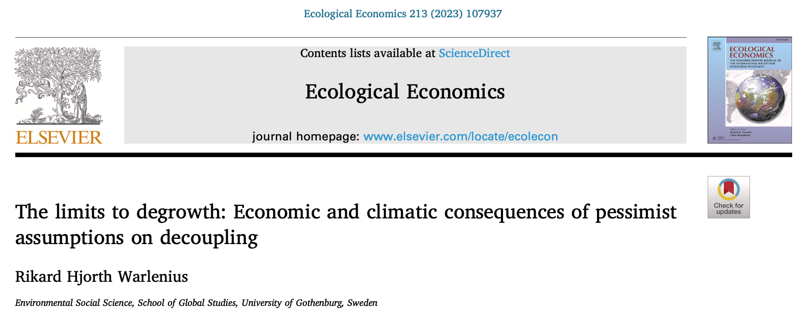
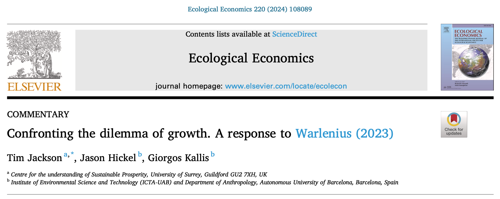
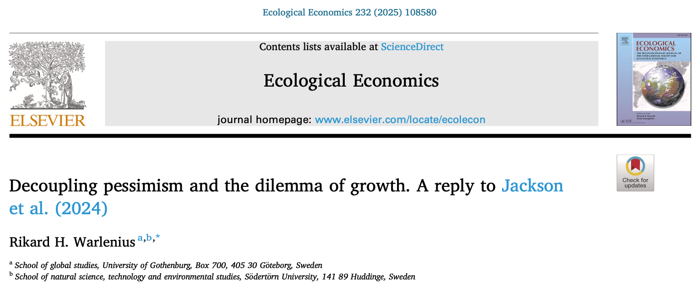
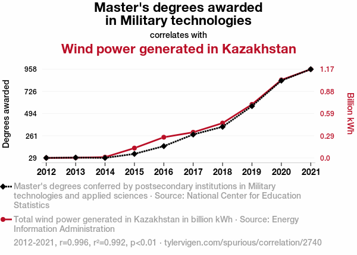
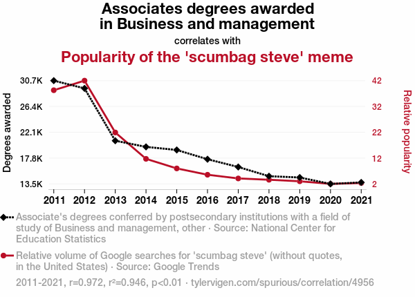
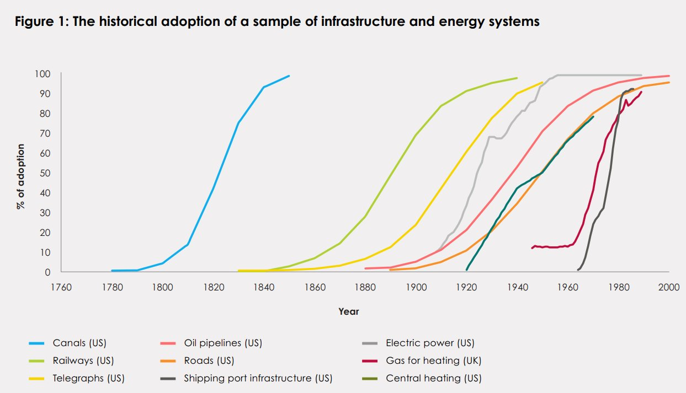

## Outline and learning goals

::: {.columns style="align-items: center; gap: 1.6em;"}
::: {.column width="42%"}
::: {.upper-roman}
I.  Decoupling foundations and theory
II. The empirical challenge: a debate about green growth, decoupling and degrowth
III. Sufficiency, degrowth policies, and where you stand
IV. Summary and conclusion
:::
:::

::: {.column width="58%"}
::: {.covers}
{fig-alt="Title of Hickel and Kallis (2020): Is Green Growth Possible?"}

{fig-alt="Title of Warlenius (2023): The limits to degrowth"}

{fig-alt="Title of Jackson, Hickel and Kallis (2024): Confronting the dilemma of growth"}

{fig-alt="Title of Warlenius (2025): Decoupling pessimism and the dilemma of growth"}
:::
:::
:::

## Decoupling foundations and theory {.divider background-color="#00395B"}

::: {.secnum}
01
:::

## The decoupling debate: growth without environmental destruction?

::: {.grid2 .caplist .nonincremental style="margin: 0.3em 0 0.7em 0;"}
::: {.cap .fragment}
[Green growth]{.caphead}

- Promoted by multilateral organisations
- Assumed in national and international policy
- Rests on **absolute decoupling** of GDP from resources and carbon, fast enough
:::

::: {.cap .fragment}
[Degrowth]{.caphead}

- Planetary boundaries → **de-growth** of production and consumption in rich countries
- Global South: away from a narrow, growth-focused development agenda
:::
:::

- Green growth advocates: boost decoupling, save growth and environment
- Degrowth advocates: prioritise the environment over growth (≠ development)

::: {.source}
Hickel & Kallis [-@hickel2020].
:::

## Defining decoupling: covariation and correlation

::: {.columns style="gap: 1.6em; align-items: flex-start;"}
::: {.column width="56%"}
- Observation: GDP and material use **move together**
  - **Co-variation**: when one changes, so does the other
  - Standardised measure: **correlation**

::: {.fragment}
$$\mathrm{Cov}(X,Y) = \frac{1}{n-1}\sum_{i=1}^{n}(x_i-\bar{x})(y_i-\bar{y})$$

$$r = \frac{\mathrm{Cov}(X,Y)}{s_X s_Y}$$
:::

- $\bar{x}$, $\bar{y}$: sample means · $s_X$, $s_Y$: sample standard deviations
- Figure: $r = 0.99$ for the two levels, 1990–2024
:::

::: {.column width="44%"}
{width="560" fig-alt="World GDP and material footprint, 1990 to 2024, index with 1990 at 1: GDP rises to 2.69, the material footprint to 2.24, and both lines move together"}
:::
:::

::: {.source}
After Hickel & Kallis [-@hickel2020], with data to 2024: World Bank, UN IRP. Code: `analysis/degrowth_02_figures.R`.
:::

## Correlation is not causation

- Correlation and covariation: **statistical relationships**
  - **Symmetric** and (for correlation) **dimensionless**
  - **No implication of causality**, no statement on causal mechanisms

::: {.spurious}
{.fragment fig-alt="Spurious correlation: master's degrees in military technologies in the US correlate with wind power generated in Kazakhstan, 2012 to 2021"}

::: {.pair .fragment}
{fig-alt="Spurious correlation: associate degrees in business and management correlate with the popularity of the scumbag Steve meme, 2011 to 2021"}

{fig-alt="The scumbag Steve meme: eats Doritos, wipes his hands on your cat"}
:::
:::

::: {.source}
Charts: [tylervigen.com/spurious](https://tylervigen.com/spurious-correlations).
:::

## The underlying culprit: two y-axis 😇

::: {.axes3}
{.fragment fig-alt="Germany, 1990 to 2023, GDP on the left axis and greenhouse gas emissions on the right axis from about 650 to 1,250 Mt: emissions fall as GDP grows"}

{.fragment fig-alt="The same data with the right axis reversed: the emissions line now rises with GDP"}

{.fragment fig-alt="The same data with the right axis from 0 to 6,000 Mt: emissions look flat"}
:::

::: {.arrow .fragment}
Two y-axes: the scale of the second axis decides the story
:::

::: {.source}
Germany, 1990–2023: GDP +56%, GHG emissions −46%, the same data in all three panels. Middle: right axis reversed. Right: right axis from 0 to 6,000 Mt. Data: World Bank; Jones et al. via Our World in Data. Code: `analysis/degrowth_02_figures.R`.
:::

## Defining decoupling: the reasons for correlation


```{=html}
<svg class="diagram sd why" viewBox="0 0 1340 215" width="1300" role="img" aria-label="Five reasons for a correlation between X and Y: X causes Y; Y causes X; mutual causation; a third variable Z causes both; coincidence, with no link">
  <circle class="var-node " cx="64" cy="120" r="28"/>
  <text class="var" x="64" y="129" text-anchor="middle">X</text>
  <circle class="var-node " cx="204" cy="120" r="28"/>
  <text class="var" x="204" y="129" text-anchor="middle">Y</text>
  <g class="fragment draw" data-fragment-index="1">
    <path class="stroke link" pathLength="1" d="M 98.0 120.0 L 156.0 120.0"/>
    <polygon class="head fill-blue" points="0,0 -14,-7 -14,7" transform="translate(168.0,120.0) rotate(0)"/>
    <text class="case" x="134" y="196" text-anchor="middle">X causes Y</text>
  </g>
  <path class="sep" d="M 268 30 L 268 200"/>
  <circle class="var-node " cx="332" cy="120" r="28"/>
  <text class="var" x="332" y="129" text-anchor="middle">X</text>
  <circle class="var-node " cx="472" cy="120" r="28"/>
  <text class="var" x="472" y="129" text-anchor="middle">Y</text>
  <g class="fragment draw" data-fragment-index="2">
    <path class="stroke link" pathLength="1" d="M 438.0 120.0 L 380.0 120.0"/>
    <polygon class="head fill-blue" points="0,0 -14,-7 -14,7" transform="translate(368.0,120.0) rotate(180)"/>
    <text class="case" x="402" y="196" text-anchor="middle">Y causes X</text>
  </g>
  <path class="sep" d="M 536 30 L 536 200"/>
  <circle class="var-node " cx="600" cy="120" r="28"/>
  <text class="var" x="600" y="129" text-anchor="middle">X</text>
  <circle class="var-node " cx="740" cy="120" r="28"/>
  <text class="var" x="740" y="129" text-anchor="middle">Y</text>
  <g class="fragment draw" data-fragment-index="3">
    <path class="stroke link" pathLength="1" d="M 626 109 L 698 109"/>
    <polygon class="head fill-blue" points="0,0 -14,-7 -14,7" transform="translate(710,109)"/>
    <path class="stroke link" pathLength="1" d="M 714 131 L 642 131"/>
    <polygon class="head fill-blue" points="0,0 -14,-7 -14,7" transform="translate(630,131) rotate(180)"/>
    <text class="case" x="670" y="196" text-anchor="middle">Mutual causation</text>
  </g>
  <path class="sep" d="M 804 30 L 804 200"/>
  <circle class="var-node " cx="868" cy="120" r="28"/>
  <text class="var" x="868" y="129" text-anchor="middle">X</text>
  <circle class="var-node " cx="1008" cy="120" r="28"/>
  <text class="var" x="1008" y="129" text-anchor="middle">Y</text>
  <g class="fragment draw" data-fragment-index="4">
    <circle class="var-node z" cx="938" cy="48" r="28"/>
    <text class="var" x="938" y="57" text-anchor="middle">Z</text>
    <path class="stroke link" pathLength="1" d="M 914.3 72.4 L 901.5 85.6"/>
    <polygon class="head fill-blue" points="0,0 -14,-7 -14,7" transform="translate(893.1,94.2) rotate(134)"/>
    <path class="stroke link" pathLength="1" d="M 961.7 72.4 L 974.5 85.6"/>
    <polygon class="head fill-blue" points="0,0 -14,-7 -14,7" transform="translate(982.9,94.2) rotate(46)"/>
    <text class="case" x="938" y="196" text-anchor="middle">Third variable Z</text>
  </g>
  <path class="sep" d="M 1072 30 L 1072 200"/>
  <circle class="var-node " cx="1136" cy="120" r="28"/>
  <text class="var" x="1136" y="129" text-anchor="middle">X</text>
  <circle class="var-node " cx="1276" cy="120" r="28"/>
  <text class="var" x="1276" y="129" text-anchor="middle">Y</text>
  <g class="fragment draw" data-fragment-index="5">
    <path class="stroke nolink" pathLength="1" d="M 1206 120 L 1172 120"/>
    <path class="stroke nolink" pathLength="1" d="M 1206 120 L 1240 120"/>
    <text class="head var q" x="1206" y="106" text-anchor="middle">?</text>
    <text class="case" x="1206" y="196" text-anchor="middle">Coincidence</text>
  </g>
</svg>
```

- **Decoupling** in the literature: breaking the link between environmental pressure and GDP
  - Relative: pressure grows, but slower than GDP · absolute: pressure falls while GDP grows
  - A **descriptive** concept: about co-movement, not about causes
- Behind a coupling: possibly a **causal mechanism**, either…
  - historically **contingent**, (technologically or socially) malleable → lasting decoupling possible
  - or **time- and space-independent** → lasting decoupling impossible

::: {.source}
Definitions: OECD [-@oecd2002].
:::

## Defining decoupling: two views on causal mechanisms

::: {.grid2 style="margin: 0.3em 0 0.9em 0;"}
::: {.cap .fragment}
[Green growth]{.caphead}

Causal mechanisms exist, but are flexible, substitutable, changeable through innovation

→ Decouple and keep growth
:::

::: {.cap .fragment}
[Degrowth]{.caphead}

Causal mechanisms exist, constrained by biophysical laws and thermodynamic limits

→ Address growth itself
:::
:::

::: {.colhead .fragment}
The little irony
:::

- Degrowth: often very critical of (mainstream) economics
- Yet degrowth position closer to **classical positivism** than the green growth view
- Green growth: more **constructivist** view of technology

## Types of decoupling: some crucial distinctions

- **Resource** or **impact** decoupling?
  - Which resources? → GHG easier to decouple than materials
- **Global** vs. **local** (→ PBA vs. CBA)
- **Permanent** vs. **temporal** · **Absolute** vs. **relative**

{.fragment .mid width="940" fig-alt="Three panels from 2000, index 2000 = 100. Türkiye: GDP +218%, domestic material consumption +281%. China: GDP +523%, greenhouse gases +206%. Germany: GDP +28%, greenhouse gases -35%"}

::: {.arrow .tight .fragment}
Coupling relationships **cannot** be inferred from these figures
:::

::: {.source}
Production-based. Data: World Bank; UN IRP; Jones et al. via Our World in Data. Code: `analysis/degrowth_02_figures.R`.
:::

## Recap from Session 7: the rebound effect

::: {.columns style="gap: 1.6em; align-items: center;"}
::: {.column width="48%"}
- Efficiency gains → actual emission reduction?
- **Direct rebound:** increased use
- **Indirect rebound:** money saved, more activity elsewhere
- Absolute decoupling even harder
  - Size and scope: varying with technology and context
- **Policy challenge:** efficiency gains without rebound
:::

::: {.column width="52%"}
{.fragment width="100%" fig-alt="Heating in German housing, 1990 to 2020, index 1990 = 100: living space per person rises to 136, heat demand per square metre falls to 72, heat demand per person ends at 98"}
:::
:::

::: {.source}
Data: Destatis, AGEB, compiled for Gräbner-Radkowitsch, Lage & Wiese [-@graebnerradkowitsch2024]. Code: `analysis/degrowth_02_figures.R`.
:::

## Group work and recap

::: {.columns style="align-items: center; gap: 2em;"}
::: {.column width="80%"}
::: {.taskbox style="margin-top: 0.8em; width: 100%; box-sizing: border-box;"}
**Small groups** · **5 minutes**

**Before looking at the data:** what would count as evidence that decoupling is 'possible'?

A single country for one year? Multiple countries over decades?

Concrete reference to mechanisms and their nature?

Which standards of evidence for claims about future decoupling potential?
:::
:::

::: {.column .qrcol .timer-xs width="20%"}
::: {#recap-timer .timer seconds="300" starton="interaction"}
:::
:::
:::

## The empirical challenge {.divider background-color="#00395B"}

::: {.secnum}
02
:::

## The empirical challenge

::: {.columns style="gap: 1.2em; align-items: flex-start;"}
::: {.column width="46%"}
- All major international organisations: absolute decoupling through policy and technology
  - Assumption: maintain growth while saving the climate
  - What does (can) the data say?

{.fragment width="500" fig-alt="The world since 1970, index 1990 = 1: by 2023 GDP reaches 2.61, the material footprint 2.19 and greenhouse gas emissions 1.62"}
:::

::: {.column width="54%"}
{.fragment width="100%" fig-alt="Recall Session 3: GDP and consumption-based CO2 per capita, index 1990 = 100, for Germany, the United States, the world, China, India and Switzerland"}
:::
:::

::: {.source}
Left: code `analysis/degrowth_02_figures.R`. Right: the figure of Session 3; code: `analysis/02_figures.R`.
:::

## Hickel & Kallis (2020): the bleak prospects for decoupling

- Data: correlations consistent with absolute decoupling, but **not enough**
- More than **4% annual decoupling** unrealistic
  - Based on the IPAT equation: degrowth the only viable option
- The **IPAT identity** (more general form of Kaya → Session 7):

::: {.columns style="align-items: center; gap: 1.4em;"}
::: {.column width="55%"}
::: {.fragment}
$$I = P \times A \times T \quad \text{with} \quad T = \frac{I}{P \times A}$$
:::
:::

::: {.column width="45%"}
::: {.ipat .fragment}
$I$: impact · $P$: population

$A$: affluence (GDP per capita)

$T$: technology (impact per unit of GDP)
:::
:::
:::

- Mathematical identity: true at any point in time
- Degrowth: reducing $A$ to drive down $I$

::: {.source}
Hickel & Kallis [-@hickel2020]; IPAT: Ehrlich & Holdren [-@ehrlich1971].
:::

## The IPAT framework and its problems

$$I = P \times A \times T \quad \text{with} \quad T = \frac{I}{P \times A}$$

- Mathematical identity: true at any point in time
- Often used as if relations were **fixed and proportional** over time
  - Changes in $A$ cause changes in $I$
- **Challenge I:** variables contingent on structural factors not in the identity (institutions, technologies, cultural patterns)
- **Challenge II:** variables not independent
  - Example: affluence might impact technology (GDP ↑ → R&D expenditures ↑)

## Warlenius (2023)'s calculation: the question

::: {.nonincremental}
- Degrowth argument: decoupling > 4% unrealistic → need to degrow
- Warlenius (2023): okay, but **how much** degrowth is needed?
  - If this was true, and the IPAT equation fixed over time
:::

```{=html}
<svg class="diagram sd rbd" viewBox="0 0 1340 92" width="1480" role="img" aria-label="A 1.5 degree target implies emission cuts of 10 percent per year. With maximum decoupling of 4 percent per year, GDP must shrink by 6.25 percent per year, which leaves the economy 86 percent smaller after 30 years">
  <g class="fragment" data-fragment-index="1">
    <rect class="node start" x="50" y="6" width="250" height="78" rx="8"/>
    <text class="on-dark" x="175" y="39" text-anchor="middle">1.5°C target ↔ 10%</text>
    <text class="on-dark" x="175" y="65" text-anchor="middle">annual emission cuts</text>
  </g>
  <g class="fragment" data-fragment-index="2">
    <text class="firm" x="340" y="55" text-anchor="middle" style="font-size: 34px;">+</text>
    <rect class="node start" x="380" y="6" width="250" height="78" rx="8"/>
    <text class="on-dark" x="505" y="39" text-anchor="middle">Max. decoupling:</text>
    <text class="on-dark" x="505" y="65" text-anchor="middle">4% per year</text>
  </g>
  <g class="fragment draw" data-fragment-index="3">
    <path class="stroke link" pathLength="1" d="M 636 45 L 694 45"/>
    <polygon class="head fill-blue" points="0,0 -14,-7 -14,7" transform="translate(706,45)"/>
    <rect class="head node " x="710" y="6" width="250" height="78" rx="8"/>
    <text class="on-light" x="835" y="39" text-anchor="middle">GDP must shrink</text>
    <text class="on-light" x="835" y="65" text-anchor="middle">6.25% per year</text>
  </g>
  <g class="fragment draw" data-fragment-index="4">
    <path class="stroke link" pathLength="1" d="M 966 45 L 1024 45"/>
    <polygon class="head fill-blue" points="0,0 -14,-7 -14,7" transform="translate(1036,45)"/>
    <rect class="head node end" x="1040" y="6" width="250" height="78" rx="8"/>
    <text class="on-light" x="1165" y="39" text-anchor="middle">After 30 years:</text>
    <text class="on-light" x="1165" y="65" text-anchor="middle">economy 86% smaller</text>
  </g>
</svg>
```

::: {.calc .fragment}
$I = A \times T \;\Rightarrow\; A = \dfrac{I}{T} \;\Rightarrow\; 1 + g_A = \dfrac{1 + g_I}{1 + g_T} = \dfrac{0.90}{0.96} = 0.9375 \;\Rightarrow\; g_A = -6.25\%$ per year

After 30 years: $0.9375^{30} = 0.144 \;\Rightarrow\; -86\%$
:::

- **Assumptions:** $P$ constant; decoupling independent of $A$; instant shrinkage → **no political economy**
- **Caveat:** 1.5°C budget now about 130 Gt CO₂ (from 2025: three years) · 2024 above 1.5°C → even steeper cuts

::: {.source}
Warlenius [-@warlenius2023]. $g$: annual growth rate; $g_T = -4\%$ is the decoupling rate. Caveat: Forster et al. [-@forster2025]; Copernicus Climate Change Service [-@copernicus2025].
:::

## Warlenius (2023)'s calculation: the results

::: {.columns style="gap: 1.6em; align-items: flex-start;"}
::: {.column width="46%"}
::: {.fragment}
::: {.colhead}
Fixed: emissions −10% per year
:::

::: {.given}
Given: $g_I = -10\%$, decoupling $g_T$ (rows)

Computed: $g_A = \dfrac{0.90}{1 + g_T} - 1$ · after 30 years: $(1 + g_A)^{30} - 1$
:::

| Decoupling per year | GDP per year | GDP after 30 years |
|---:|---:|---:|
| 0% | −10% | −96% |
| **−4%** | **−6.2%** | **−86%** |
| −7% | −3.2% | −63% |
| −10% | 0% | 0% |
| −12% | +2.3% | +96% |

: {.econ .warl .hi4}
:::
:::

::: {.column width="54%"}
::: {.fragment}
::: {.colhead}
Fixed: decoupling 4% per year
:::

::: {.given}
Given: $g_T = -4\%$, emissions $g_I$ (rows)

Computed: $g_A = \dfrac{1 + g_I}{0.96} - 1$ · after 30 years: $(1 + g_I)^{30} - 1$, $(1 + g_A)^{30} - 1$
:::

| Emissions per year | GDP per year | Emissions after 30 years | GDP after 30 years |
|---:|---:|---:|---:|
| 0% | +4.2% | 0% | +240% |
| −2% | +2.1% | −45% | +86% |
| −4% | 0% | −71% | 0% |
| −7% | −3.1% | −89% | −61% |
| **−10%** | **−6.2%** | **−96%** | **−86%** |

: {.econ .warl .hi3}
:::
:::
:::

::: {.arrow .fragment}
Same point in both tables: 1.5°C target and 4% decoupling
:::

::: {.source}
Warlenius [-@warlenius2023], Tables 1 and 2, selected rows. Shaded: constant GDP. Bold: the case on the previous slide.
:::

## Warlenius (2023)'s calculation: what it means by country

::: {.columns style="gap: 1.6em; align-items: flex-start;"}
::: {.column width="46%"}
- **Punchline:** with 4% decoupling fixed, how much countries would need to degrow
  - Assumption: convergence of per capita incomes
- 4% ceiling forces a choice:
  - Give up ambitious climate targets
  - Give up development and fairness goals
  - Or assume that developed countries crash their economies
:::

::: {.column width="54%"}
::: {.fragment}
| GDP per capita after 30 years | GDP per capita 2021 | 1.5°C | 2°C |
|:---|---:|---:|---:|
| Least developed countries | 1,177 | +17% | +739% |
| Nigeria | 2,085 | −34% | +373% |
| India | 2,277 | −39% | +334% |
| Indonesia | 4,292 | −68% | +130% |
| Brazil | 7,519 | −82% | +31% |
| World | 12,263 | −89% | −19% |
| China | 12,556 | −89% | −21% |
| EU | 38,234 | −96% | −74% |
| Germany | 51,204 | −97% | −81% |
| U.S.A. | 69,287 | −98% | −86% |

: {.econ .warl .t3}
:::
:::
:::

::: {.keybox .fragment}
Is this desirable? Is this realistic? And what does "degrowth" mean at $1,177 per capita?
:::

::: {.notes}
**What degrowth means at $1,177 per capita:** in Warlenius's own calculation the least developed countries still grow (+17% under 1.5°C), because incomes converge. Degrowth proponents say the same: degrowth is for high-income countries, and it frees energy and materials for countries where growth is still needed. For the South they ask for debt cancellation, an end to unequal exchange, and productive capacity directed to social goals (Hickel et al. 2022). The open question is the dependency on Northern demand, see below.

**Global South and degrowth, what each reference adds:**

- Gräbner-Radkowitsch & Strunk (2023): the twin problem of global dependencies. Gräbner-Radkowitsch & Strunk (2026): in 2017, roughly a ninth of incomes and profits in the South depended on trade with the North, mostly via intermediate goods, with large differences between regions.
- Leoni, Jackson & Jackson (2026): stock-flow consistent model. A unilateral Northern transition brings a balance-of-payments crisis in the South. A North-to-South transfer helps the South, but raises global resource use and instability in the North.
- Ricci (2025): delinking of the South combined with degrowth of the North.
- Rodríguez-Labajos et al. (2019): tensions between degrowth and environmental justice movements in the South.
:::

::: {.source}
Warlenius [-@warlenius2023], Table 3, selected rows. Global emissions −10% (1.5°C) or −4% (2°C) per year, decoupling 4%. Global South and degrowth: Gräbner-Radkowitsch & Strunk [-@graebnerradkowitsch2023; -@graebnerradkowitsch2026]; Leoni, Jackson & Jackson [-@leoni2026]; Ricci [-@ricci2025]; Rodríguez-Labajos et al. [-@rodriguezlabajos2019].
:::

## Warlenius (2023)'s calculation: the alternative

<!-- Redrawn from Warlenius (2023), Diagram 1: GDP(t) = 100 * (0.9 / (1 - d))^t. -->

::: {.columns style="gap: 1.2em; align-items: flex-start;"}
::: {.column width="56%"}
```{=html}
<svg class="diagram sd gp" viewBox="0 0 800 480" width="800" role="img" aria-label="GDP over 30 years if carbon emissions fall by 10 percent per year, index with start at 100. No decoupling: minus 96 percent. 4 percent decoupling: minus 86 percent. 7 percent: minus 63 percent. 10 percent: GDP constant. 12 percent: plus 96 percent">
  <path class="ax" d="M 70 410 L 560 410"/>
  <text class="lg" x="60" y="417" text-anchor="end">0</text>
  <path class="ref" d="M 70 318 L 560 318"/>
  <text class="lg" x="60" y="324" text-anchor="end">50</text>
  <path class="ref" d="M 70 225 L 560 225"/>
  <text class="lg" x="60" y="232" text-anchor="end">100</text>
  <path class="ref" d="M 70 132 L 560 132"/>
  <text class="lg" x="60" y="140" text-anchor="end">150</text>
  <path class="ref" d="M 70 40 L 560 40"/>
  <text class="lg" x="60" y="47" text-anchor="end">200</text>
  <text class="lg" x="70" y="438" text-anchor="middle">0</text>
  <text class="lg" x="233" y="438" text-anchor="middle">10</text>
  <text class="lg" x="397" y="438" text-anchor="middle">20</text>
  <text class="lg" x="560" y="438" text-anchor="middle">30</text>
  <text class="lg" x="315" y="466" text-anchor="middle">Years</text>
  <text class="lg" text-anchor="middle" transform="translate(16,225) rotate(-90)">GDP, index (start = 100)</text>
  <g class="fragment draw" data-fragment-index="1">
    <path class="stroke sc0" pathLength="1" d="M 70.0 225.0 L 86.3 243.5 L 102.7 260.1 L 119.0 275.1 L 135.3 288.6 L 151.7 300.8 L 168.0 311.7 L 184.3 321.5 L 200.7 330.4 L 217.0 338.3 L 233.3 345.5 L 249.7 351.9 L 266.0 357.8 L 282.3 363.0 L 298.7 367.7 L 315.0 371.9 L 331.3 375.7 L 347.7 379.1 L 364.0 382.2 L 380.3 385.0 L 396.7 387.5 L 413.0 389.8 L 429.3 391.8 L 445.7 393.6 L 462.0 395.2 L 478.3 396.7 L 494.7 398.0 L 511.0 399.2 L 527.3 400.3 L 543.7 401.3 L 560.0 402.2"/>
    <text class="lbl" x="570" y="420">No decoupling: −96%</text>
  </g>
  <g class="fragment draw" data-fragment-index="2">
    <path class="stroke sc4" pathLength="1" d="M 70.0 225.0 L 86.3 236.6 L 102.7 247.4 L 119.0 257.6 L 135.3 267.1 L 151.7 276.0 L 168.0 284.4 L 184.3 292.2 L 200.7 299.6 L 217.0 306.5 L 233.3 313.0 L 249.7 319.0 L 266.0 324.7 L 282.3 330.1 L 298.7 335.1 L 315.0 339.7 L 331.3 344.1 L 347.7 348.2 L 364.0 352.1 L 380.3 355.7 L 396.7 359.1 L 413.0 362.3 L 429.3 365.3 L 445.7 368.1 L 462.0 370.7 L 478.3 373.1 L 494.7 375.5 L 511.0 377.6 L 527.3 379.6 L 543.7 381.5 L 560.0 383.3"/>
    <text class="lbl" x="570" y="379">4%: −86%</text>
  </g>
  <g class="fragment draw" data-fragment-index="3">
    <path class="stroke sc7" pathLength="1" d="M 70.0 225.0 L 86.3 231.0 L 102.7 236.7 L 119.0 242.3 L 135.3 247.7 L 151.7 253.0 L 168.0 258.0 L 184.3 262.9 L 200.7 267.7 L 217.0 272.3 L 233.3 276.7 L 249.7 281.0 L 266.0 285.2 L 282.3 289.2 L 298.7 293.1 L 315.0 296.9 L 331.3 300.5 L 347.7 304.1 L 364.0 307.5 L 380.3 310.8 L 396.7 314.0 L 413.0 317.1 L 429.3 320.1 L 445.7 323.0 L 462.0 325.8 L 478.3 328.5 L 494.7 331.1 L 511.0 333.7 L 527.3 336.1 L 543.7 338.5 L 560.0 340.8"/>
    <text class="lbl" x="570" y="348">7%: −63%</text>
  </g>
  <g class="fragment draw" data-fragment-index="4">
    <path class="stroke sc10" pathLength="1" d="M 70.0 225.0 L 86.3 225.0 L 102.7 225.0 L 119.0 225.0 L 135.3 225.0 L 151.7 225.0 L 168.0 225.0 L 184.3 225.0 L 200.7 225.0 L 217.0 225.0 L 233.3 225.0 L 249.7 225.0 L 266.0 225.0 L 282.3 225.0 L 298.7 225.0 L 315.0 225.0 L 331.3 225.0 L 347.7 225.0 L 364.0 225.0 L 380.3 225.0 L 396.7 225.0 L 413.0 225.0 L 429.3 225.0 L 445.7 225.0 L 462.0 225.0 L 478.3 225.0 L 494.7 225.0 L 511.0 225.0 L 527.3 225.0 L 543.7 225.0 L 560.0 225.0"/>
    <text class="lbl" x="570" y="232">10%: GDP constant</text>
  </g>
  <g class="fragment draw" data-fragment-index="5">
    <path class="stroke sc12" pathLength="1" d="M 70.0 225.0 L 86.3 220.8 L 102.7 216.5 L 119.0 212.1 L 135.3 207.6 L 151.7 203.0 L 168.0 198.3 L 184.3 193.5 L 200.7 188.6 L 217.0 183.5 L 233.3 178.4 L 249.7 173.1 L 266.0 167.7 L 282.3 162.2 L 298.7 156.6 L 315.0 150.8 L 331.3 144.9 L 347.7 138.9 L 364.0 132.8 L 380.3 126.5 L 396.7 120.0 L 413.0 113.4 L 429.3 106.7 L 445.7 99.8 L 462.0 92.7 L 478.3 85.5 L 494.7 78.2 L 511.0 70.6 L 527.3 62.9 L 543.7 55.0 L 560.0 46.9"/>
    <text class="lbl" x="570" y="54">12%: +96%</text>
  </g>
</svg>
```
:::

::: {.column width="44%"}
- **Alternative view:** push decoupling
- Figure refers to IPAT: emissions −10% per year
- Sneaked-in assumptions:
  - $A$ and $T$ might be interdependent
  - Relationships might be non-linear
- The meta-theoretical debate: **how stable are the relationships between environmental impact and GDP?**
:::
:::

::: {.source}
Redrawn from Warlenius [-@warlenius2023], Diagram 1.
:::

## The remainder of the debate

::: {.covers .two}
{fig-alt="Title of Jackson, Hickel and Kallis (2024): Confronting the dilemma of growth"}

{fig-alt="Title of Warlenius (2025): Decoupling pessimism and the dilemma of growth"}
:::

- Mainly about who really claimed a limit to decoupling… but worth reading!

::: {.keybox .fragment}
"Our differences revolve around **the question of capitalism**: can it be expected to stop growing, and is it likely to disappear within short? If the answer to both questions is no, strong decoupling is our best chance to avoid runaway climate change." [@warlenius2025, p. 1]
:::

::: {.source}
Jackson, Hickel & Kallis [-@jackson2024]; Warlenius [-@warlenius2025].
:::

## Group discussion

::: {.columns style="align-items: center;"}
::: {.column width="80%"}
Choose one (or two) of the following guiding questions · **10 minutes**
:::

::: {.column .qrcol .timer-xs width="20%"}
::: {#discussion-timer .timer seconds="600" starton="interaction"}
:::
:::
:::

::: {.grid3 style="margin-top: 0.6em;"}
::: {.cap .fragment}
[The 'camps']{.caphead}

If degrowth advocates accept that high levels of decoupling are necessary: what actually distinguishes degrowth from green growth? Feasibility, or something deeper?
:::

::: {.cap .fragment}
[IPAT and its implications]{.caphead}

$I = P \times A \times T$: which assumptions about interdependence, linearity or stability are most problematic? What does it imply for the debate?
:::

::: {.cap .fragment}
[Scale and speed]{.caphead}

Green growth: unprecedented technological acceleration. Degrowth: unprecedented economic contraction. Which seems more plausible?
:::
:::

## Sufficiency, degrowth policies, and where you stand {.divider background-color="#00395B"}

::: {.secnum}
03
:::

## Sufficiency: between green growth and degrowth?

::: {.grid3 style="margin: 0.2em 0 0.6em 0;"}
::: {.cap .fragment}
[Green growth]{.caphead}

Acts on $T$: efficiency, renewables

GDP: grows
:::

::: {.cap .fragment .suff}
[Sufficiency]{.caphead}

Acts on **activity levels** where impact is high: living space, km travelled, product lifetimes

GDP: no target
:::

::: {.cap .fragment}
[Degrowth]{.caphead}

Acts on $A$: planned reduction of production and consumption in rich countries

GDP: falls
:::
:::

- **Corridors**: upper and lower limits for consumption → room to grow below the floor
- Policies: public transport instead of private cars, renovation instead of new buildings, repair and recycling requirements
- Contested: overall impacts less well understood · Global South: feasibility, neo-colonial agenda

::: {.arrow .fragment}
Scenario example: CLEVER (Session 7), about half of the energy savings from sufficiency
:::

::: {.source}
Gräbner-Radkowitsch, Lage & Wiese [-@graebnerradkowitsch2024]; IPCC [-@ipcc2022, WGIII]; Creutzig et al. [-@creutzig2022]; Zell-Ziegler et al. [-@zellziegler2021]; Bourgeois et al. [-@clever2023].
:::

## Degrowth as a programme: what is proposed?

::: {.grid2 .caplist .nonincremental style="margin-top: 0.2em;"}
::: {.cap .fragment}
[Reduce less-necessary production]{.caphead}

- Fossil fuels, mass-produced meat and dairy, fast fashion, advertising, cars, aviation
- Longer product lifespans, no planned obsolescence
:::

::: {.cap .fragment}
[Universal public services]{.caphead}

- Health care, education, housing, transport, energy, food
- Good social outcomes with low resource use
:::

::: {.cap .fragment}
[Green jobs guarantee, shorter working time]{.caphead}

- Jobs in renewables, insulation, care → just transition out of sunset sectors
- Four-day week, lower retirement age → stable employment as production shrinks
:::

::: {.cap .fragment}
[Room for the Global South]{.caphead}

- Cancel unfair and unpayable debts, curb unequal exchange
- Productive capacity for social goals, where growth is still needed
:::
:::

::: {.arrow .fragment}
Funding without growth: no fossil subsidies, taxes on damaging sectors, wealth taxes
:::

::: {.notes}
All proposals as in Hickel et al. (2022), Nature. Their justification: universal services deliver strong social outcomes without high resource use; a job guarantee ends unemployment and secures a just transition for workers in fossil and other sunset sectors; shorter working time lowers emissions, frees time for care, and stabilises employment as less-necessary production declines. Existing examples they name: free health care and education in many European countries, public housing in Vienna and Singapore, free public transport in nearly 100 cities, trials of basic incomes and shorter hours in Finland, Sweden and New Zealand. Open research questions they list: growth dependencies of welfare and pensions, capital flight, inflation, and political feasibility.
:::

::: {.source}
Hickel et al. [-@hickel2022]; see also Hickel [-@hickel2020a].
:::

## Where would you position yourself?

::: {.grid3 .caplist .nonincremental style="margin-top: 0.3em;"}
::: {.cap .fragment}
[Green growth optimism]{.caphead}

- Warlenius calculation: degrowth unrealistic
- Much higher decoupling rates than 4% achievable
- Innovation requires economic resources: degrowth counterproductive
- Focus: massive investment in R&D and green technology deployment
:::

::: {.cap .fragment}
[Green growth pragmatism]{.caphead}

- Some decoupling possible, but not at required speed and scale
- Portfolio approach: some efficiency gains + some demand reduction (sufficiency)
- Selective degrowth in high-impact sectors, growth in low-impact services
:::

::: {.cap .fragment}
[Degrowth necessity]{.caphead}

- Calculation confirms: growth incompatible with climate targets
- Innovation and efficiency have limits
- Political feasibility of degrowth and technological optimism both uncertain
- Better planned degrowth than risking collapse
- Maybe systemic changes inevitable
:::
:::

## My personal hope: new technologies can spread fast

::: {.columns style="gap: 1.6em; align-items: flex-start;"}
::: {.column width="50%"}
{width="92%" fig-alt="Adoption of new goods in US households, 1860 to 2019: flush toilets, refrigerators, stoves, washing machines, cars, radial tires, microwaves and dishwashers each spread from a few percent to most households within a few decades"}
:::

::: {.column width="50%"}
::: {.colhead}
Infrastructures and energy systems
:::

{.fragment width="100%" fig-alt="S-curves of adoption in percent, 1760 to 2000: canals, railways, telegraphs, oil pipelines, roads, shipping port infrastructure, electric power, gas for heating and central heating in the US and UK"}
:::
:::

::: {.arrow .tight .fragment}
Argument: new technologies spread within 20–30 years → fast decoupling not absurd
:::

::: {.arrow .tight .fragment}
Counter: so far, new energy sources came **in addition** to old ones, not instead of them
:::

::: {.source}
Left: Comin & Hobijn (2004) and others via Our World in Data; code: `analysis/degrowth_02_figures.R`. Right: Systemiq [-@systemiq2023], Figure 1, based on Sovacool [-@sovacool2016] and others. Counter-argument: York & Bell [-@york2019].
:::

## Summary & conclusion {.divider background-color="#00395B"}

::: {.secnum}
04
:::

## Summary and outlook

- At the heart of the debate: disagreement about the **feasibility of decoupling**
- Important methodological terms:
  - Covariance, correlation, causation, coupling
  - Types of decoupling: absolute, relative, territorial, global, temporal,…
- Both camps argue **within GDP** → beyond-GDP indicators, Session 3
- Meta-theoretical disagreement: time- and space-dependence of causal mechanisms
  - Green growth: causal mechanisms exist, but are flexible
  - Degrowth: causal mechanisms exist and are fixed
- **Sufficiency**: limits on activity levels where impact is high, between green growth and degrowth
- Insightful debate: Hickel & Kallis (2020), Warlenius (2023), Jackson et al. (2024), Warlenius (2025)
- Policy implications? → Discuss in country groups

## Guiding questions for country groups

::: {.grid3 .caplist .nonincremental style="margin-top: 0.3em;"}
::: {.cap}
[Historical decoupling]{.caphead}

- One environmental stressor (CO₂, material use, land use, etc.)
- Decoupling rates for your country, past 10–20 years
- Relative or absolute decoupling?
:::

::: {.cap .fragment}
[Future requirements]{.caphead}

- National and international targets: which combinations of GDP growth and decoupling rates needed?
:::

::: {.cap .fragment}
[Policy portfolio]{.caphead}

- Which combination of efficiency, substitution and demand measures?
- Which sectors to grow, which to contract?
- Which political, social, distributional challenges?
:::
:::

## References and further reading {.smaller .scrollable}

::: {#refs}
:::
